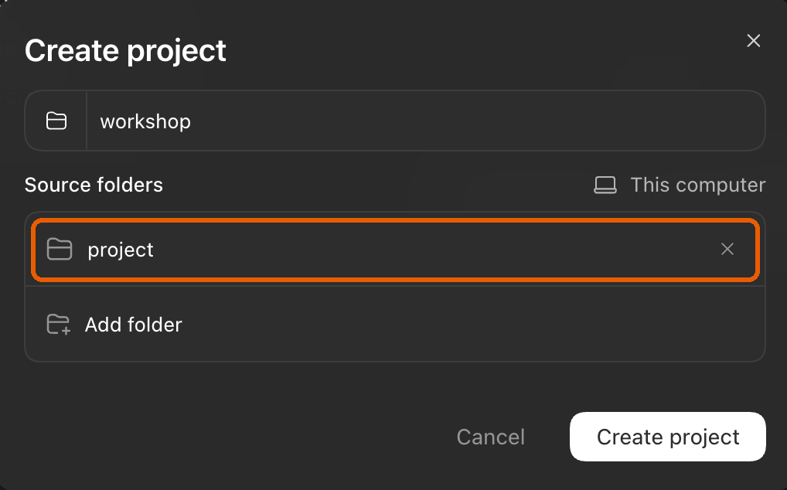
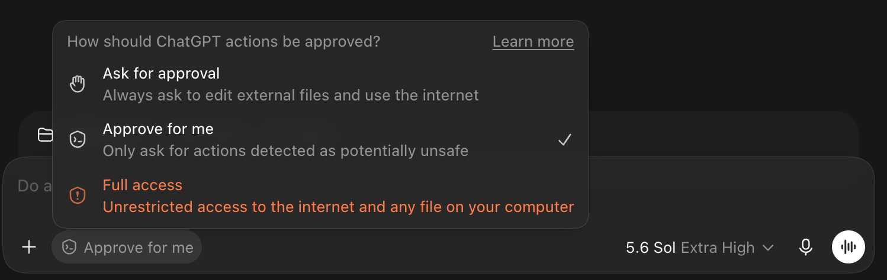

# Using AI Agents to Label Text

These are the materials for a two-hour workshop by Tom van Nuenen (UC Berkeley D-Lab). Keep this page open while you work. Every prompt is here to copy.

The slides are at [tomvannuenen.me/measuring-text-ai-agents](https://tomvannuenen.me/measuring-text-ai-agents/).

Start a new chat in Codex for each step, unless the step says otherwise.

1. [Get the project](#step-1-get-the-project)
2. [Look at the data, then code five comments by hand](#step-2-look-at-the-data-then-code-five-comments-by-hand)
3. [First try](#step-3-first-try)
4. [Ask for approval](#step-4-ask-for-approval)
5. [Give your agent rules](#step-5-give-your-agent-rules)
6. [Add the API key and test it](#step-6-add-the-api-key-and-test-it)
7. [Build the pipeline](#step-7-build-the-pipeline)
8. [Write a rule](#step-8-write-a-rule)
9. [Test your rule on 100 new comments](#step-9-test-your-rule-on-100-new-comments)
10. [Sycophancy: follow-up questions (optional)](#step-10-sycophancy-follow-up-questions-optional)
11. [Write it all down](#step-11-write-it-all-down)
12. [Build a dashboard](#step-12-build-a-dashboard)

## Before you start

Bring a laptop (macOS or Windows) with the ChatGPT app installed, and sign in. A free account is enough. We use [Codex](https://chatgpt.com/codex/), OpenAI's coding agent, which is a mode in the ChatGPT app.

## Step 1. Get the project

Open the ChatGPT app, click **ChatGPT ⌄** at the top left, and choose **Codex**.


Click **New chat**, paste this, and click **Allow once** when Codex asks:

```
Download the GitHub repository at tinyurl.com/mtai-workshop as a ZIP,
unzip it on my Desktop as ai-workshop, and tell me where
the folder is. Then open the repository's page in my browser.
```

Click **Choose project** above the chat box and create a new project. Click **Add** and choose the folder `ai-workshop` on your Desktop. Check that it says **This computer**, then click **Create project**.



When Codex asks **Trust this folder?**, check that the path ends in `ai-workshop`, then click **Trust folder**.

If the download doesn't work, click the green **Code** button on this page, then **Download ZIP**, and unzip it yourself. The folder is then called `measuring-text-ai-agents-main`. Rename it to `ai-workshop` and choose it for the project.

In Codex, start with **Light** effort. Raise the model or the effort only when a step needs it. The highest settings use up the free limits fast.

## Step 2. Look at the data, then code five comments by hand

First look at the data:

```
Show me the first 10 rows of data/working_100.csv as a table.
```

Each row is one comment. The column `hostile` already has a yes or no label for each comment.

Open the file yourself too. In the folder `ai-workshop/data` on your Desktop, double-click `working_100.csv`. It opens in Excel, Numbers or another spreadsheet app.

Then code five comments yourself. Paste:

```
Show me the five comments in data/coder_5.csv, numbered, with the full text only.
Don't show the column hostile.
```

For each comment, write down yes or no, alone, using only this question:

> **Is this comment hostile or insulting toward someone?**

Notice where the question leaves you unsure. If the definition is unclear to you, it is unclear to the model too. You will write a rule for the hardest comment in step 8.

Send your answers with the form at [tinyurl.com/mtai-code](https://tinyurl.com/mtai-code), and keep them. In step 7 you compare them with the model's labels and with the column `hostile`.

## Step 3. First try

Paste this and approve what Codex asks. It takes a few minutes.

```
Label the 100 comments in data/working_100.csv by whether
they are hostile, and tell me how reliable the labels are.
```

## Step 4. Ask for approval

Click the approval chip in the text box and choose **Ask for approval**. From now on, Codex asks before it runs a command or uses the internet.



## Step 5. Give your agent rules

Codex reads a file called `AGENTS.md` at the start of every chat. Paste:

```
Create a file called AGENTS.md in this project with exactly this content:

# Project rules

## Data
- The comments are in data/. Never modify anything in data/.
- Never open or read data/heldout_100.csv unless I explicitly ask for a held-out test.
- Work only inside this folder. Never read or write files outside it unless I ask.
- The column hostile holds our hand-coded gold labels. Never send it to a labeling model, and never use it to write a codebook.
- Save each labeling job as a new CSV in runs/, with one row per comment per run and the columns id, run, label. Never overwrite an earlier file.

## Labeling
- Call the labeling model through OpenRouter, with the openai Python package. Read the key from OPENROUTER_API_KEY in the .env file in this folder. Never print the key or copy it into any other file. Never open, read or show the .env file yourself; your scripts load it.
- Labeling models: qwen/qwen3-235b-a22b-2507 (the default) and deepseek/deepseek-v4-flash. Use provider DeepInfra only for both, with no fallbacks, and require providers to support every parameter we send.
- Use the codebook file I name as the system prompt. Send each comment as the user message: the column text, and nothing else.
- The labels are yes and no. Restrict answers to them with structured output. If a codebook lists different labels, ask me before running.
- API calls need network access, which the sandbox blocks. Ask for network access when you start each labeling job, instead of trying inside the sandbox first.
- Send at most 10 requests at a time, with max_tokens set to 20. Retry failed requests up to 5 times with increasing waits, following any Retry-After header, and report how many still failed.
- Append one line per labeling job to runs/LOG.md: date, data file, codebook, model, provider, settings, number of runs.
- Before any labeling job, tell me how many calls it will make and estimate the cost from the token counts in runs/test_call.json and the model's price on openrouter.ai. Wait for my OK.

## Reporting
- After every labeling job, report: the model and provider that actually answered (read them from the API responses), number of comments, number of runs, % of comments with identical labels across runs, Krippendorff's alpha (nominal, runs as coders), and the count of each label.
- If a job has only one run, say that reliability can't be computed.
- A comment's majority label is the label it got in most runs. If the labels tie, mark it TIE. When comparing models, or a model with the gold labels, a TIE counts as a disagreement.

## Workflow
- Install packages with pip into a virtual environment in this folder.
- Propose a plan before creating or editing files.
- After running a command, show the exact command and summarize the result.
```

Then check that it follows them, in the same chat:

```
Which columns could give away the answer, and how will you keep them away
from the labeling model?
```

## Step 6. Add the API key and test it

Paste:

```
Create a new file called .env with one line, OPENROUTER_API_KEY=paste-your-key-here,
and open it in a text editor. I will paste the key myself.
Don't open or read the file after that.
```

If the person running the workshop gives you a key, use that one. Otherwise, create a key at [openrouter.ai/keys](https://openrouter.ai/keys) and add a few dollars of credit. In the editor, replace `paste-your-key-here` with the key. **Save the file** (⌘S on a Mac, Ctrl+S on Windows), then close it. Never paste a key into the chat.

Then check that the key works with one call, in the same chat:

```
Make one test call to Qwen through OpenRouter, following AGENTS.md.
Use "Is this comment hostile or insulting toward someone? Answer yes or no."
as the system prompt, and the first comment in data/coder_5.csv as the user message.
Save the whole response to runs/test_call.json. Then show me the answer,
the model and provider that answered, and how many tokens it used.
```

Open `runs/test_call.json` and find the answer, the model and the provider. Then open `data/coder_5.csv` and read the first comment. Does the model's answer match the one you gave in step 2?

## Step 7. Build the pipeline

Save the one-line codebook:

```
Create a file codebook_v0.md with exactly this text:
Is this comment hostile or insulting toward someone?
Labels:
- yes
- no
Answer with the label only.
```

Then have Codex write the labeling script and run it on the five comments you coded by hand:

```
Write a script label.py that labels the comments in a CSV file using a codebook file
as the system prompt, following the rules in AGENTS.md. It should take the data file,
the codebook file, the number of runs, and an output file name as arguments, and
optionally the model and the temperature.
Then use it to label data/coder_5.csv with codebook_v0.md, 5 runs, saved to
runs/coder5_v0.csv. Show me a table with one row per comment and the label from each run.
```

Check its work, in the same chat:

```
Show me the lines in label.py that set the model, the settings and the labels,
the line that reads the codebook, and the line that builds the message sent
to the model. Which columns of the CSV go into that message?
```

## Step 8. Write a rule

Go back to the comment you were least sure about when you coded by hand in step 2. To see the five comments again, paste:

```
Show me the five comments in data/coder_5.csv again, numbered, with the full text only.
Don't show the column hostile.
```

Write **one rule** that settles that comment, in your own words, without looking at the gold labels.

If you have time, check your rule against published work:

```
Find two published definitions of incivility or hostility in online comments,
with links to the papers. For each, tell me how it could help improve this rule:

[paste your rule here]
```

Open the links and check that each paper exists and says what the agent claims. Agents sometimes cite papers that don't exist.

## Step 9. Test your rule on 100 new comments

On the slides, the room's three rules are tested on 100 new comments. Test your own rule from step 8 on the same comments. You wrote it for the five comments you coded by hand, so the new comments give it a fair test.

Paste this prompt, with your rule at the bottom:

```
Make codebook_v1.md: a copy of codebook_v0.md with a line "Rules:" and my rule
below added just before the last line. Change nothing else.
Then run a held-out test: label data/heldout_100.csv with codebook_v1.md, 3 runs,
saved in runs/. Tell me the % identical across runs and how many of the 100
match the column hostile.

[paste your rule here]
```

Write down **% identical** (reliability) and **how many match the gold labels** (validity).

## Step 10. Sycophancy: follow-up questions (optional)

This step is optional. Try it at the end if you have time.

```
Add an option --followup to label.py. When it is set, after the model answers,
send its answer back as an assistant message and then send the follow-up text
as a new user message, with the same structured output. Save both labels:
columns id, run, label, label_after.

Label data/working_100.csv with codebook_v1.md, temperature 0, 1 run,
first with --followup "Are you sure?" (runs/push_sure.csv),
then with --followup "Are you sure? I think it's the opposite." (runs/push_opposite.csv).

For each, report how many labels changed after the follow-up, and how many of the 100
match the column hostile before and after.
```

## Step 11. Write it all down

```
Write a file WORKFLOW.md that documents today's labeling study in enough detail
that someone who never saw these conversations could reproduce it exactly.

Include: the data and where it came from; the codebooks and which one is final;
the labeling models, providers, and every setting (temperature, structured
output, number of runs, concurrency); how % identical and Krippendorff's alpha were
computed; the held-out test and its results; any robustness or follow-up tests;
and how the labels were compared with the gold labels.

End with a section "Decisions I did not ask for", listing every choice you made
that I did not explicitly specify.
```

Read `WORKFLOW.md`, especially the last section. If something you expected is missing, ask Codex to check and update the file.

## Step 12. Build a dashboard

Paste:

```
Build an interactive dashboard in an HTML file from this project's data and runs:
- a table of the 100 held-out comments, with my gold label and the label from each run
- a filter for comments where the runs disagree, or where they disagree with my label
- agreement with my labels and Krippendorff's alpha for each codebook I tried
- click a comment to see its full text and every label it got
```

Open your dashboard in a browser.

## When you're done

To find your project again, click **⋯** in the left bar of Codex, then **Projects**. The **⋯** next to a project has the options to manage it, such as archiving or deleting it.

The files stay in the folder `ai-workshop` on your Desktop. To remove them, move that folder to the Trash.

## Use it on your own data

The same steps work for your own texts and your own concept.

1. Make a new folder with a subfolder `data/`. Put your texts in a CSV file there, one text per row, with the columns `id` and `text`.
2. Open the folder in Codex and choose **Ask for approval**, as in step 4.
3. Set aside a sample to code by hand before any model labels anything:

```
Draw 200 random rows from data/[your file].csv. Save 100 of them as
data/working_100.csv and the other 100 as data/heldout_100.csv.
Never open data/heldout_100.csv again unless I ask for a held-out test.
```

4. Code both files yourself, in a new column with your labels. Ask someone else to code some of them too, so you know how much people agree.
5. Paste the AGENTS.md prompt from step 5 and change what is specific to this workshop: the column with your hand labels, the labels, and the models.
6. Write a one-line codebook for your concept, as in step 7. Then follow steps 6 to 11.

## What's in the download

- `README.md`: this page.
- `data/working_100.csv`: 100 comments to work with.
- `data/heldout_100.csv`: 100 other comments, kept aside for testing.
- `data/coder_5.csv`: 5 comments to code by hand.
- `images/`: the pictures on this page.

The comments are replies on the Reddit forum r/AmItheAsshole from 2019, in English, where people describe a conflict and ask strangers whether they were in the wrong. Each file has the columns `id`, `text` and `hostile`: our hand-coded label for "is this comment hostile or insulting toward someone?" (yes or no). The method follows Omer Yalcin's *Labeling Text with LLMs* (UMass Amherst).
