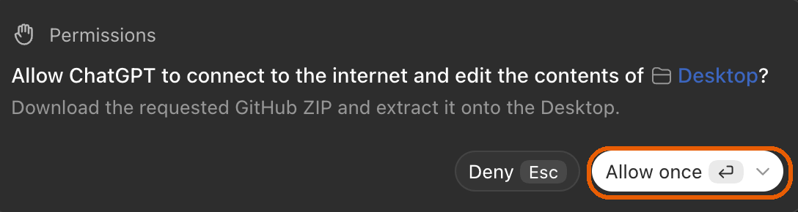
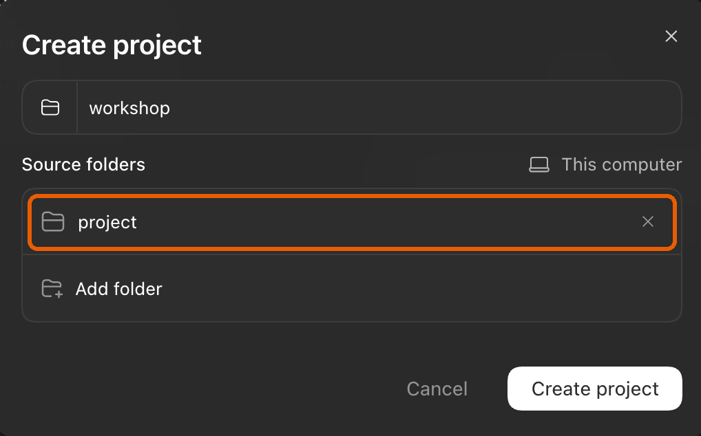
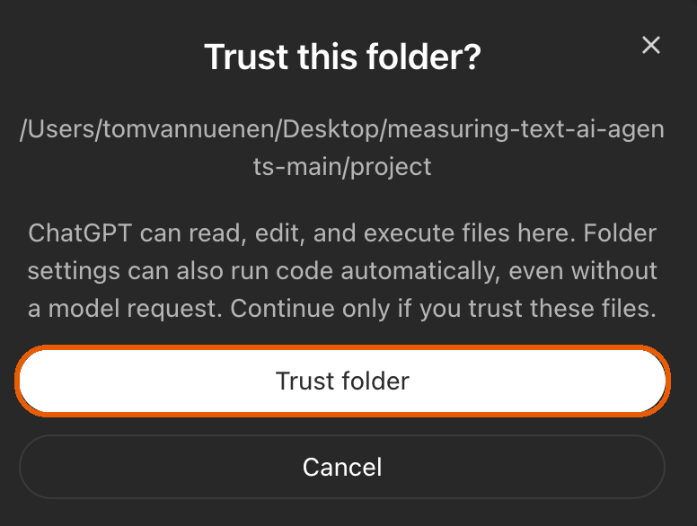
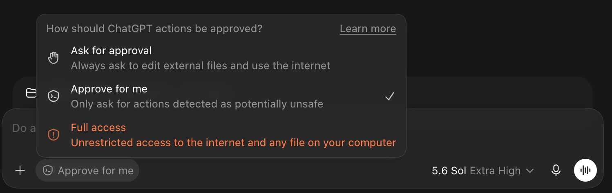

# Measuring Text with AI Agents: Setup

### Learning Objectives

- Distinguish a chat assistant from a coding agent.
- Code five comments by hand, and see where coders disagree.
- Open the project folder in the Codex app and give the agent a first task in one sentence.
- Set permissions and give the agent written rules in `AGENTS.md`.
- Add the API key that lets your code call a language model.

### Icons Used in This Workshop
🔔 **Question**: A quick question to check your understanding.<br>
🥊 **Challenge**: Interactive exercise. We'll work through these together.<br>
💡 **Tip**: How to do something a bit more efficiently or effectively.<br>
⚠️ **Warning:** Heads-up about tricky stuff or common mistakes.

### Sections
1. [What Is a Coding Agent?](#section1)
2. [Get the Project](#section2)
3. [Code Five Comments by Hand](#section2a)
4. [First Try: One Sentence](#section2b)
5. [Permissions](#section3)
6. [Give Your Agent Rules](#section4)
7. [Add the API Key](#section5)

<a id='section1'></a>

# What Is a Coding Agent?

You have probably used a chatbot like ChatGPT or Claude. You type a question and it writes an answer.

A **coding agent** can also *act* on your computer. It reads your files, writes code, runs it, looks at the result, and decides on its next step. Today we use **Codex**, OpenAI's agent, which comes with the ChatGPT app. Claude Code and Google's Antigravity work the same way.

Three things are different from a chatbot:

- The agent works inside a **project folder**. That folder is its world.
- Everything it does is **recorded**. You can open every command it ran.
- It asks for **permission** before acting, if you tell it to.

Today's project is a measurement problem that social scientists know well: **coding text**. On the Reddit forum r/AmItheAsshole, people describe a conflict and ask strangers whether they were in the wrong. We'll have a language model code 100 of the replies for **hostility**: is the comment hostile or insulting toward someone? Then we ask how much we can trust those labels.

🔔 **Question:** You ask a chatbot to "label these comments" and it gives you labels. You ask an agent the same thing. What is different about what happens next, and about what you can check afterwards?

<a id='section2'></a>

# Get the Project

1. Open the ChatGPT app, click **ChatGPT ⌄** at the top left, and choose **Codex**.

<center>

</center>

2. Click **New chat** and paste:

```
Download github.com/tomvannuenen/measuring-text-ai-agents as a ZIP,
unzip it on my Desktop, and tell me where the folder is.
```

Codex asks to connect to the internet and edit your Desktop. Click **Allow once**.

<center>

</center>

3. Click **Choose project** under the chat box and create a new project. In **Create project**, give it a name, click **Add**, and choose the folder `project` inside `measuring-text-ai-agents-main` on your Desktop. Click **Create project**.

<center>

</center>

4. Codex asks **Trust this folder?** Check that the path ends in `measuring-text-ai-agents-main/project`, then click **Trust folder**.

<center>

</center>

💡 **Tip:** If the download doesn't work, open [github.com/tomvannuenen/measuring-text-ai-agents](https://github.com/tomvannuenen/measuring-text-ai-agents) yourself, click the green **Code** button, then **Download ZIP**, and unzip it.

The project folder looks like a small research project:

| File | Contents |
|---|---|
| `README.md` | What the data is |
| `data/coder_5.csv` | 5 short comments for the warm-up |
| `data/working_100.csv` | 100 comments we label and study |
| `data/heldout_100.csv` | 100 *different* comments we keep aside for testing |

Every comment comes with a **gold label** in the column `hostile` (yes or no). We coded these comments ourselves with a detailed codebook. They are our best reading, not the truth: for about one comment in five, a careful second coder could disagree.

The rest of the download sits one level up, outside the project: these exercises, and a `backup` folder with results we prepared earlier, in case the internet or the API fails. Your agent doesn't need them.

💡 **Tip:** Not sure where the folder is? Ask the agent: "What folder are we in? Give me the full path."

<a id='section2a'></a>

# Code Five Comments by Hand

## 🥊 Challenge 1: You Are the Coder

Before any agent labels anything, you code a few comments yourself. Scan the QR code on the screen and answer the form on your phone. For each comment, choose **yes** or **no**, using only this question:

```
Is this comment hostile or insulting toward someone?
```

Work alone, and take about four minutes. We come back to your answers in exercise 2, after a model has coded the same five comments.

These five comments are in `data/coder_5.csv`, with our gold labels in the column `hostile`.

<a id='section2b'></a>

# First Try: One Sentence

## 🥊 Challenge 2: Just Ask

Before any rules or settings, give the agent the task the way many people would. Paste:

```
Label the 100 comments in data/working_100.csv by whether
they are hostile, and tell me how reliable the labels are.
```

Approve what it asks. It takes a few minutes; we look at the slides meanwhile.

If it labels nothing, ask:

```
So you did not label anything, like I asked?
```

🔔 **Questions:**
- Did it write code, or read the comments and decide? Click "Worked for …" above its reply to see each step.
- Did it mention the `hostile` column?
- What did it report as "reliable"? Which number?
- Did it save its labels to a file? If so, how many of its labels match the `hostile` column?

## Conversations

Inside a project you can start many **conversations**. Keep to **one conversation per task**. Files persist between conversations; the chat history does not. If a decision lives only in the chat, the next conversation won't know it.

## Model and Effort

The small chip in the text box (something like `GPT-6.2 Sol Light`) sets which model the agent uses and how much effort it spends. The defaults are fine. If you hit the free tier's usage limit, choose a smaller model or lower effort.

💡 **Tip:** This is the model that *writes your code*. Later today your code calls a *different* model to label the comments. Keep the two apart. They can each vary from run to run, for different reasons.

<a id='section3'></a>

# Permissions

Click the approval chip in the text box. There are three levels:



⚠️ **Warning:** From now on, set it to **`Ask for approval`**. The agent will ask before running commands or using the internet. You'll click "approve" often. That's the point: you see every step.

<a id='section4'></a>

# Give Your Agent Rules

Agents follow the instructions in a file called `AGENTS.md`. The agent reads it at the start of every conversation. Copy and paste this prompt:

```
Create a file called AGENTS.md in this project with exactly this content:

# Project rules

## Data
- The comments are in data/. Never modify anything in data/.
- Never open or read data/heldout_100.csv unless I explicitly ask for a held-out test.
- Work only inside this folder. Never read or write files outside it unless I ask.
- The column hostile holds our hand-coded gold labels. Never send it to a labeling model, and never use it to write a codebook.
- Save each labeling job as a new CSV in runs/, with one row per comment per run and the columns id, run, label. Never overwrite an earlier file.

## Labeling
- Call the labeling model through OpenRouter, with the openai Python package. Read the key from OPENROUTER_API_KEY in the .env file in this folder. Never print the key or copy it into any other file.
- Labeling models: qwen/qwen3-235b-a22b-2507 (the default) and deepseek/deepseek-v4-flash. Use provider DeepInfra only for both, with no fallbacks, and require providers to support every parameter we send.
- Use the codebook file I name as the system prompt. Send each comment as the user message: the column text, and nothing else.
- The labels are yes and no. Restrict answers to them with structured output. If a codebook lists different labels, ask me before running.
- Send at most 8 requests at a time. Retry failed requests up to 5 times with increasing waits, and report how many still failed.
- Append one line per labeling job to runs/LOG.md: date, data file, codebook, model, provider, settings, number of runs.

## Reporting
- After every labeling job, report: the model and provider that actually answered (read them from the API responses), number of comments, number of runs, % of comments with identical labels across runs, Krippendorff's alpha (nominal, runs as coders), and the count of each label.
- If a job has only one run, say that reliability can't be computed.
- A comment's majority label is the label it got in most runs. If the labels tie, mark it TIE. When comparing models, or a model with the gold labels, a TIE counts as a disagreement.

## Workflow
- Install packages with pip into a virtual environment in this folder.
- Propose a plan before creating or editing files.
- After running a command, show the exact command and summarize the result.
```

🔔 **Question:** Which of these rules protect the *data*, which protect the *measurement*, and which protect *you*?

💡 **Tip:** `AGENTS.md` steers the agent, but it doesn't guarantee anything. In long conversations instructions can get lost. Check that the agent follows them.

💡 **Tip:** Keep the rules short, and write them yourself. In a 2026 benchmark, short rules written by people raised agents' success rate from 34% to 51%. Rules that the agents wrote for themselves made results worse (Li et al. 2026, SkillsBench).

## Check the Rules

```
Look at the files in this project and tell me what they contain.
Don't change anything yet.
```

Did it stay inside the folder and leave `heldout_100.csv` alone, as `AGENTS.md` says? Then ask it directly:

```
Which columns could give away the answer, and how will you keep them away
from the labeling model?
```

<a id='section5'></a>

# Add the API Key

Your code will send the comments to a language model through **OpenRouter**, a service that gives one access point to many models. For today we provide a temporary key with a small spending limit. It will be switched off after the workshop.

Files whose names start with a dot, like `.env`, are hidden in Finder and Explorer, so let the agent create and open it:

```
Create a file called .env with one line, OPENROUTER_API_KEY=paste-your-key-here,
and open it in a text editor, so I can paste the key myself.
```

In the editor, replace `paste-your-key-here` with the key the instructor gives you, then save and close.

💡 **Tip:** To see hidden files yourself, press `Cmd + Shift + .` in a Finder window (Mac). In Windows Explorer, use View → Show → Hidden items.

⚠️ **Warning:** Never paste an API key into the chat or into code. Keep it in `.env`. If you share your project later, leave `.env` out.

💡 **Tip:** No key, or the API isn't working? Every exercise today also works with our results in the `backup` folder, one level up from `project`. The lessons say where.

# Key Points

- A **coding agent** acts on your files. A chatbot only answers.
- Asked in one sentence, the agent makes every decision itself: the definition, the method, and what "reliable" means.
- Work in a **project folder**, one conversation per task.
- Keep permissions on **Ask for approval** while learning.
- `AGENTS.md` holds your project rules. Today they include how labels are stored and reported.
- Two models are involved today: the **agent** that writes code, and the **labeling model** your code calls.
