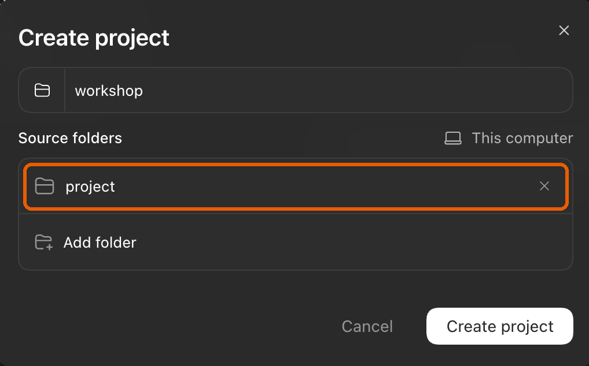
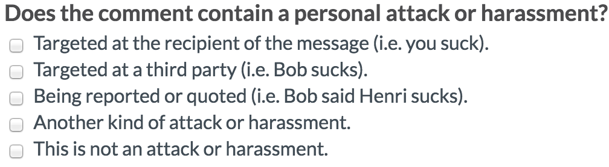
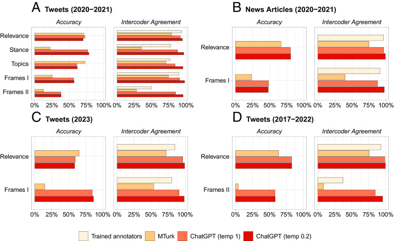
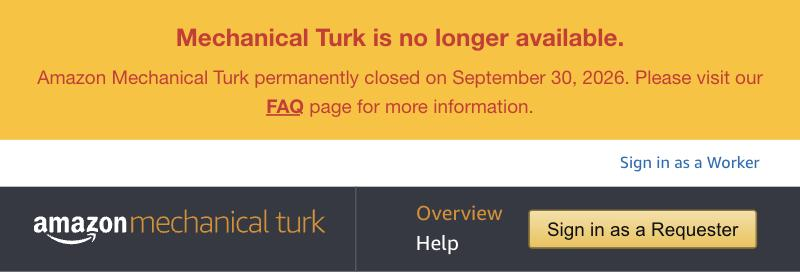
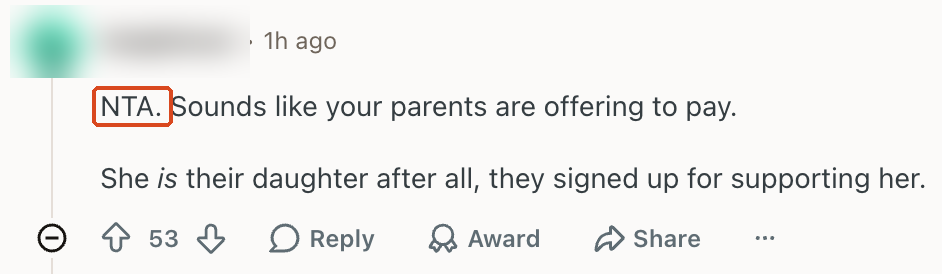
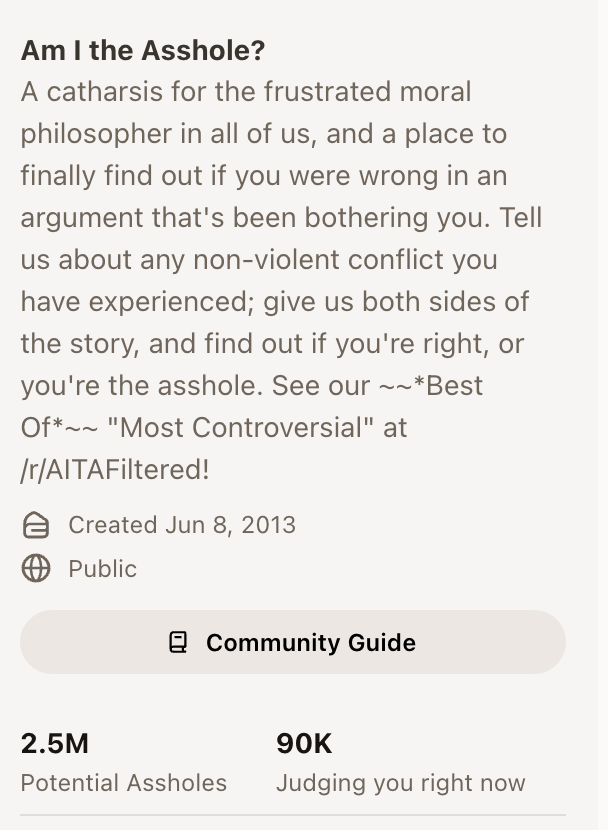
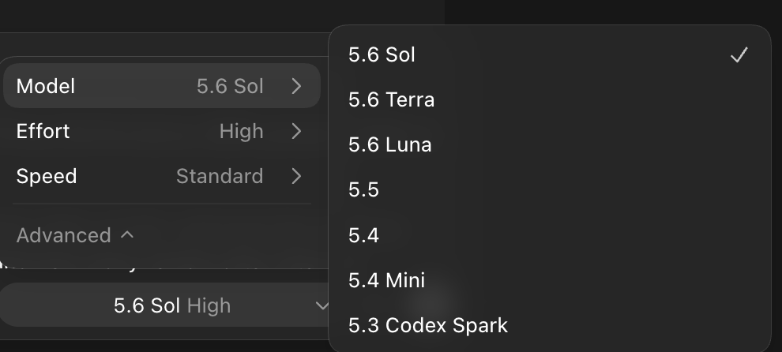
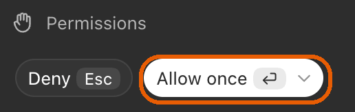
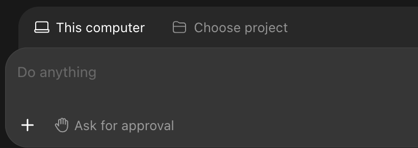
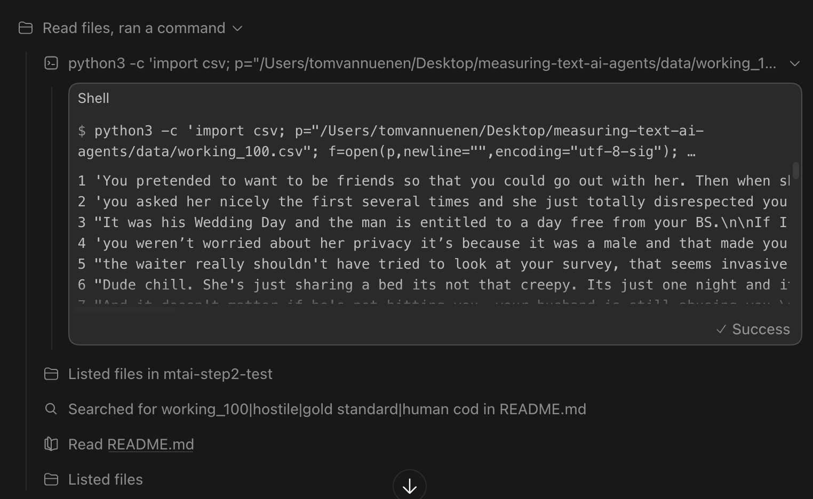

# Using AI Agents to Label Text

Tom van Nuenen · UC Berkeley D-Lab · São Paulo, November 2026

Slides: <b style="color:#d9481f;">tomvannuenen.me/measuring-text-ai-agents</b>

---

## Get Codex on your laptop

<ol style="font-size:34px; line-height:1.6;">
<li>Download the ChatGPT app for macOS or Windows at <b>chatgpt.com/download</b>.</li>
<li>Open it and sign in. A free account is enough.</li>
<li>Click <b>ChatGPT ⌄</b> at the top left and choose <b>Codex</b>.</li>
</ol>

Do this now. You will need Codex in a few minutes.

If you can’t install Codex, please follow along on the shared screen.

---

## Your perceptions

---

## Large language models (LLMs)

<ul style="font-size:27px; line-height:1.4; margin:0 0 20px 1em; text-align:left;"><li class="fragment">An LLM is trained on huge amounts of text.</li><li class="fragment">ChatGPT, Claude and Gemini are powered by LLMs.</li><li class="fragment">An LLM writes by picking the next word, again and again.</li></ul>

---

## Temperature

<ul style="font-size:27px; line-height:1.4; margin:0 0 6px 1em; text-align:left;"><li>Temperature sets how spread out the chances are.</li><li class="fragment tp-step">A high temperature spreads the chances over more words.</li><li class="fragment tp-step">A low temperature gives the top word almost all the chance.</li><li class="fragment tp-step">Temperature 0 always picks the top word.</li></ul>

---

## Context windows

---

## Agents

<ul style="font-size:28px; line-height:1.45; margin:6px 0 24px 1em; max-width:1000px; text-align:left;"><li class="fragment">An agent is an LLM with tools.</li><li class="fragment">It reads files, runs Python, searches the web and makes charts.</li><li class="fragment">Today you use Codex.</li></ul>

<svg viewBox="0 0 900 330" width="900" height="330" style="font-family:inherit; overflow:visible; display:block; margin:0 auto;"><line x1="195" y1="72" x2="375.0" y2="145" stroke="#bbb" stroke-width="2.5"/><path d="M110,50 h24 l7,8 h39 v42 h-70 z" stroke="#111" stroke-width="3" fill="none" stroke-linecap="round" stroke-linejoin="round"/><text x="145" y="138" text-anchor="middle" font-size="22" fill="#111">read and write files</text><line x1="195" y1="252" x2="375.0" y2="185" stroke="#bbb" stroke-width="2.5"/><rect x="110" y="226" width="70" height="52" rx="7" stroke="#111" stroke-width="3" fill="none" stroke-linecap="round" stroke-linejoin="round"/><path d="M124,242 l12,10 l-12,10" stroke="#111" stroke-width="3" fill="none" stroke-linecap="round" stroke-linejoin="round"/><line x1="142" y1="264" x2="162" y2="264" stroke="#111" stroke-width="3" fill="none" stroke-linecap="round" stroke-linejoin="round"/><text x="145" y="318" text-anchor="middle" font-size="22" fill="#111">write and run code</text><line x1="705" y1="72" x2="525.0" y2="145" stroke="#bbb" stroke-width="2.5"/><circle cx="755" cy="72" r="29" stroke="#111" stroke-width="3" fill="none" stroke-linecap="round" stroke-linejoin="round"/><ellipse cx="755" cy="72" rx="12" ry="29" stroke="#111" stroke-width="3" fill="none" stroke-linecap="round" stroke-linejoin="round"/><line x1="726" y1="72" x2="784" y2="72" stroke="#111" stroke-width="3" fill="none" stroke-linecap="round" stroke-linejoin="round"/><path d="M730,58 h50 M730,86 h50" stroke="#111" stroke-width="3" fill="none" stroke-linecap="round" stroke-linejoin="round"/><text x="755" y="138" text-anchor="middle" font-size="22" fill="#111">search the web</text><line x1="705" y1="252" x2="525.0" y2="185" stroke="#bbb" stroke-width="2.5"/><path d="M724,222 v58 h64" stroke="#111" stroke-width="3" fill="none" stroke-linecap="round" stroke-linejoin="round"/><rect x="734" y="252" width="12" height="24" fill="#111"/><rect x="752" y="236" width="12" height="40" fill="#d9481f"/><rect x="770" y="244" width="12" height="32" fill="#111"/><text x="755" y="318" text-anchor="middle" font-size="22" fill="#111">make a chart</text><rect x="375.0" y="123.0" width="150" height="84" rx="12" fill="#111"/><text x="450" y="176" text-anchor="middle" font-size="32" font-weight="700" fill="#fff">LLM</text></svg>

---

## How agents work

1
The agent works inside a <b>project folder</b> on your machine. That folder is its world. It reads and changes the files inside it.

2
Everything it does is <b>recorded</b>. You can inspect every command it ran.

3
It asks for <b>permission</b> before it goes outside the folder or online.

---

## Get the workshop files

Step 1

Every prompt today is on our GitHub page, a website that stores project files. Open it now and keep it open.

tinyurl.com/mtai-workshop

Copy the step 1 prompt into a <b>New chat</b> in Codex. Click <b>Allow once</b>.

Download the GitHub repository at tinyurl.com/mtai-workshop as a ZIP, unzip it on my Desktop as ai-workshop, and tell me where the folder is. Then open the repository's page in my browser.

You can also open the link yourself, click Code → Download ZIP, and rename the folder ai-workshop.

---

## Make the folder a project

Step 1

<ol style="font-size:28px; line-height:1.45; margin:0; text-align:left;">
<li>Above the chat box, click <b>Choose project</b>, then <b>New project</b>.</li>
<li>Click <b>Add</b> and choose the folder <code>ai-workshop</code> on your Desktop.</li>
<li>Check that it says <b>This computer</b>, then click <b>Create project</b>.</li>
<li>If Codex asks <b>Trust this folder?</b>, click <b>Trust folder</b>.</li>
</ol>

Start every new chat in this project. Codex then works only inside this folder.

---

## Text labeling in the social sciences

<ul style="font-size:28px; line-height:1.3; margin:2px 0 14px 1em; max-width:1040px; text-align:left;"><li class="fragment" style="margin-bottom:8px;">Labeling assigns each text to a category, such as “positive” or “negative”. It is the core of content analysis. Krippendorff 2018</li><li class="fragment" style="margin-bottom:8px;">Social scientists label speeches, news, party manifestos and online comments to measure concepts such as policy positions or incivility.</li><li class="fragment" style="margin-bottom:8px;">Researchers count the labels and compare groups.</li><li class="fragment" style="margin-bottom:8px;">Errors in the labels change these results. TeBlunthuis, Hase &amp; Chan 2024</li><li class="fragment">Today an LLM labels Reddit comments for <b>hostility</b>, and we check its labels.</li></ul>

Reddit commentHostile?

“Protect your son. He is a child and an emotionally vulnerable one with special needs.”
→no

“…you knocked her up like a dumbass. You don’t get to impose your will as you see fit.”
→yes

Hostile: <b style="color:#d9481f;">1 of 2</b>

---

## Text labeling through the years

since1950sPeople label texts on paper sheets. Berelson 1952

since1960sComputers count dictionary words. Stone et al. 1966

since1980sResearchers tag text in software. ATLAS.ti, NVivo

since2000sCrowd workers label for pay. Mechanical Turk, 2005

since2020sLanguage models label from a written instruction. Gilardi, Alizadeh &amp; Kubli 2023

<figure class="era-fig">

LABELING SHEET Story no. 0412

Topic: &nbsp;☐ politics &nbsp;☒ economy &nbsp;☐ crime

Tone toward the government: ☐ positive &nbsp;☒ neutral &nbsp;☐ negative

Labeler: R.M. &nbsp;&nbsp; Date: 3/11/1952

<figcaption>An illustration of a paper labeling sheet</figcaption></figure><figure class="era-fig"><figcaption>The General Inquirer ran on IBM mainframes like this 7090. Photo: NASA, public domain.</figcaption></figure><figure class="era-fig"><figcaption>The US Policy Agendas Project. Two trained people label most bills and laws by policy topic.</figcaption></figure><figure class="era-fig"><figcaption>Crowd workers answered this question for over 100,000 Wikipedia comments. Wulczyn, Thain &amp; Dixon 2017</figcaption></figure><figure class="era-fig"><figcaption>ChatGPT against MTurk workers and trained labelers on tweets and news. Gilardi, Alizadeh &amp; Kubli 2023</figcaption></figure>

---

## Are language models the future of text labeling?

ChatGPT labeled tweets more accurately than MTurk crowd workers, at <b>1/30 the cost</b> Gilardi, Alizadeh &amp; Kubli 2023, PNAS

<b>46%</b> of NLP papers in 2025 used a language model to evaluate their results. <b>43%</b> used people. Yang et al. 2026

---

## Reliability, validity and labeler bias

Reliability

The same comment gets the same label when you ask again.

One comment, five runs

yesyesyesyesyes

Today you run the model several times on the same comments.

Validity

The label matches what we mean (a "gold label")

One comment

model says yesgold label says yes✓

Today you compare the model’s labels with our gold labels.

Labeler bias

The label changes when something changes that should not matter.

One comment, two versions

as written: yeshe → she: no✗

Later you see how models react to changes like this.

---

## r/AmItheAsshole

People describe a conflict and ask strangers to judge them.

↑ The commenter writes the verdict.

He broke up with you because you were ashamed to be with him. … First thing y’all did in public as a couple. How cute :D

← A labeler must decide if this is hostile.

---

## This workshop has two parts

→
Hostile or insulting toward someone? yes no

1. Working with an agent

<ul style="font-size:28px; line-height:1.35; margin:0 0 0 1em; text-align:left;">
<li>What an agent is, and how it works in a project folder</li>
<li>Rules for the agent, and checking its log</li>
<li>The agent writes a script, and a model labels through the API</li>
</ul>

2. Checking the labels

<ul style="font-size:28px; line-height:1.35; margin:0 0 0 1em; text-align:left;">
<li><b>Reliability:</b> the same label when you ask again</li>
<li><b>Validity:</b> the label matches the gold label</li>
<li><b>Labeler bias:</b> something irrelevant changes the label</li>
</ul>

---

## Measurement Validity

1
<b>Background concept</b>hostility in online talk

↓ conceptualization

2
<b>Systematized concept</b>“attacks a person: insults, mockery, threats, contempt”

↓ operationalization

3
<b>Indicator</b>the prompt: one line, or the codebook

↓ scoring

4
<b>Scores</b>yes or no for each comment

check, then revise

Adcock &amp; Collier (2001), “Measurement Validity: A Shared Standard for Qualitative and Quantitative Research,” <i>American Political Science Review</i>

---

## The model you pick changes the result

---

## Model and effort

<ul style="font-size:28px; line-height:1.35; margin:0 0 0 1em; text-align:left;"><li>The <b>model</b> is the brain of the agent.</li><li>Bigger, newer models do more, and use more of your limit.</li></ul>
<ul style="font-size:28px; line-height:1.35; margin:0 0 0 1em; text-align:left;"><li><b>Effort</b> is how long it thinks.</li><li>More effort helps on hard tasks, and uses more of your limit.</li></ul>

Codex lets you do a set amount of work every 5 hours. This is your <b>usage limit</b>.

Codex messages per 5 hours, Plus plan (note: you are on a Free plan!)

small model

💬 350–3,000

Sol

💬 17–180

biggest model

💬 6–50

<b style="color:#d9481f;">Start with Light effort.</b> See your usage at chatgpt.com/codex/settings/usage. OpenAI, Codex pricing page, November 2026

---

## The folder you downloaded

ai-workshop/

your Codex project

README.md

the workshop page, with every step

data/coder_5.csv

5 comments to label by hand

data/working_100.csv

100 comments to label

data/heldout_100.csv

100 comments kept for testing

images/

pictures for the workshop page

Each data file has three columns: <code>id</code>, <code>text</code> and <code>hostile</code>.

---

## Open the data first

Step 2

<pre class="ft-code" style="margin:0 0 14px;"><code class="nohighlight" style="font-size:23px; padding:8px 18px;">Show me the first 10 rows of data/working_100.csv as a table.</code></pre>

<table style="width:100%; border-collapse:collapse; margin:0;"><thead><tr><th style="padding:10px 16px; text-align:left; font-family:monospace; font-size:26px; border-bottom:2px solid #111; width:15%;">id</th><th style="padding:10px 16px; text-align:left; font-family:monospace; font-size:26px; border-bottom:2px solid #111;">text</th><th style="padding:10px 16px; text-align:left; font-family:monospace; font-size:26px; border-bottom:2px solid #111; width:16%; color:#d9481f;">hostile</th></tr></thead><tbody>
<tr><td style="padding:12px 16px; border-bottom:1px solid #ddd; vertical-align:top; font-family:monospace; font-size:18px; color:#888;">t1_emiclu6</td><td style="padding:12px 16px; border-bottom:1px solid #ddd; vertical-align:top; font-size:24px; line-height:1.3;">“If the guy wanted to close your bag, he could have told you that your bag was open. 99% chance he’s a pickpocket, 1% socially dysfunctional idiot.”</td><td style="padding:12px 16px; border-bottom:1px solid #ddd; vertical-align:top; font-size:26px; font-weight:700; color:#d9481f; white-space:nowrap;">yes</td></tr>
<tr><td style="padding:12px 16px; border-bottom:1px solid #ddd; vertical-align:top; font-family:monospace; font-size:18px; color:#888;">t1_ejielm1</td><td style="padding:12px 16px; border-bottom:1px solid #ddd; vertical-align:top; font-size:24px; line-height:1.3;">“Don’t pick up random drinks in a club, that’s just plain rude. Also, don’t get blackout drunk/high when you’re out with someone.”</td><td style="padding:12px 16px; border-bottom:1px solid #ddd; vertical-align:top; font-size:26px; font-weight:700; color:#111; white-space:nowrap;">no</td></tr>
<tr><td style="padding:12px 16px; border-bottom:1px solid #ddd; vertical-align:top; font-family:monospace; font-size:18px; color:#888;">t1_eci2a24</td><td style="padding:12px 16px; border-bottom:1px solid #ddd; vertical-align:top; font-size:24px; line-height:1.3;">“She’s playing the Shitty Life Olympics. It’d be one thing to bring it up in a productive and mature way, but…”</td><td style="padding:12px 16px; border-bottom:1px solid #ddd; vertical-align:top; font-size:26px; font-weight:700; color:#d9481f; white-space:nowrap;">yes
ambiguous
</td></tr>
</tbody></table>

Reddit’s id

the comment: all a labeler sees

our gold labels 40 of 100 “yes”

Copy it from step 2 on the GitHub page. Then open the file yourself: in <code>ai-workshop/data</code> on your Desktop, double-click <code>working_100.csv</code>.

---

## Label five comments by hand

Step 2

If the definition is unclear to you, it is unclear to the model too.

---

## Your first try: just ask for labels

Step 3

Start a new chat, click <b>Choose project</b> and pick <code>ai-workshop</code>. Then paste step 3 from the GitHub page and approve what Codex asks.

<pre class="ft-code"><code class="nohighlight" style="font-size:26px; padding:18px 22px;">Label the 100 comments in data/working_100.csv by whether
they are hostile, and tell me how reliable the labels are.</code></pre>

Copy it from step 3 on the GitHub page.

---

## The agent’s log

Step 3

<ul style="font-size:29px; line-height:1.3; margin:0 0 0 1em;">
<li style="margin-bottom:18px;">Click <b>Read files, ran a command</b>, then a command.</li>
<li style="margin-bottom:18px;">The box shows what the model saw.</li>
<li style="margin-bottom:18px;">Open your own log. Did a command print <code>hostile</code>?</li>
<li class="fragment" style="margin-bottom:18px;">The log never shows why the agent chose a label.</li>
<li class="fragment" style="margin-bottom:18px;">A reason per label helps with disagreements. The model writes that reason itself, so it may not be the real reason. Turpin et al. 2023</li>
</ul>

---

## Your agent’s reliability number

Which number did your agent report as reliability? How did it get that number?

My labels agreed with the existing hand-coded labels on 98 of 100 comments, with Cohen’s κ = 0.96.

My agent, GPT-6.2 Sol on Light

Codex had read my labels before it labeled. The score says nothing about reliability. In Codex's own words: “The comparison is unblinded.”

---

## Maximum effort for everything?

The effort menu in Codex
<svg viewBox="0 0 380 256" width="100%" role="img" aria-label="A big sledgehammer labeled maximum effort swinging down on one tiny nut labeled yes or no." style="display:block; margin-top:16px; background:#fff; border:1px solid #d6d6cf; border-radius:8px;">
<defs>
<linearGradient id="steel" x1="0" y1="0" x2="1" y2="0"><stop offset="0" stop-color="#b9bec6"/><stop offset=".5" stop-color="#7d838c"/><stop offset="1" stop-color="#555b63"/></linearGradient>
<linearGradient id="wood" x1="0" y1="0" x2="0" y2="1"><stop offset="0" stop-color="#d39a5c"/><stop offset="1" stop-color="#9c6a38"/></linearGradient>
</defs>
<text x="190" y="32" text-anchor="middle" style="font-size:22px; font-weight:800; letter-spacing:1px;" fill="#d9481f">MAXIMUM EFFORT</text>
<g transform="rotate(16 186 206)">
<rect x="206" y="130" width="140" height="17" rx="6" fill="url(#wood)" stroke="#7a5228" stroke-width="1.5"/>
<rect x="312" y="128" width="36" height="21" rx="7" fill="#2b2b2b"/>
<rect x="160" y="72" width="52" height="134" rx="6" fill="url(#steel)" stroke="#3f444b" stroke-width="2"/>
<rect x="160" y="72" width="52" height="13" rx="4" fill="#4a4f57"/>
<rect x="160" y="193" width="52" height="13" rx="4" fill="#4a4f57"/>
</g>
<ellipse cx="170" cy="232" rx="11" ry="7" fill="#c8a26a" stroke="#8a6a3a" stroke-width="2"/>
<line x1="30" y1="241" x2="350" y2="241" stroke="#bbb" stroke-width="2"/>
<text x="192" y="236" style="font-size:21px;" fill="#6f6f69">yes / no</text>
</svg>

<ul style="font-size:30px; line-height:1.3; margin:0 0 0 1em;">
<li style="margin-bottom:18px;">It may be tempting to always pick the highest effort.</li>
<li class="fragment" style="margin-bottom:18px;">But: longer thinking has been shown to make yes-or-no labels worse in some cases. Huang &amp; Wang 2026</li>
<li class="fragment" style="margin-bottom:18px;">Reasoning on easy questions can cost many times more tokens, for the same answer. Chen et al. 2024</li>
<li class="fragment" style="margin-bottom:18px;">High effort helps on long tasks. One label is a short task.</li>
</ul>

---

## Light or high effort

GPT-6.2 Sol, the same request, in two new copies of the project. Light is the free default.

Light

High

time

<b style="font-size:28px; width:150px;">39 s</b>

<b style="font-size:28px; width:150px;">3 min 06 s</b>

commands

<b style="font-size:28px; width:150px;">4</b>

<b style="font-size:28px; width:150px;">10</b>

tokens it wrote, thinking included

<b style="font-size:28px; width:150px;">1,500</b>

<b style="font-size:28px; width:150px;">6,000</b>

what it read

every row, with my labels

the text, and how many of my labels say hostile (40)

same as mine

98 of 100

97 of 100

High took five times as long, for the same score.

---

## What is an API?

You can use a big LLM in two ways. People use a chat app. Programs use an <b>API</b>, which lets a program send the model text and get its answer back.

---

## The agent and the labeling model

<b style="color:#d9481f;">1</b>&nbsp; The agent writes <code>label.py</code> once. It never sees the API key.

<b style="color:#d9481f;">2</b>&nbsp; <code>label.py</code> sends one comment at a time to Qwen and saves the labels.

working_100.csv

text

Your aunt is…

She can choose…

Honestly…

ESH, both…

gold label

🔒

never sent

→

label.py

codebook settings

→

Qwen

via the API

every call logged

→

run 5 yes no yes no

run 4 yes no yes no

run 3 yes no yes no

run 2 yes no yes no

run 1 yes no yes no

Hosted models change over time, which is called <b>drift</b>. Write down the model version, the provider and the date. Chen, Zaharia &amp; Zou 2023

---

## One long chat or one call per comment

One long chat

your instructions

files it listed

commands and their output

comment 1, comment 2 … comment 100

the labels so far
<ul style="font-size:28px; line-height:1.3; margin:12px 0 0 1em; text-align:left;"><li>Each label depends on everything before it.</li><li>Early instructions can get lost.</li><li>Labels can change over time.</li></ul>

One call per comment

codebook

comment 1

codebook

comment 2

… one call for each comment
<ul style="font-size:28px; line-height:1.3; margin:12px 0 0 1em; text-align:left;"><li>The codebook never changes.</li><li>One comment at a time.</li><li><code>label.py</code> works this way.</li></ul>

---

## AGENTS.md

ai-workshop/ &nbsp;&nbsp;<b style="color:#d9481f; border:2px solid #d9481f; border-radius:6px; padding:0 6px;">AGENTS.md</b> &nbsp;&nbsp;README.md &nbsp;&nbsp;data/

AGENTS.md

# Project rules
- Never modify anything in data/.
- The column hostile holds our gold labels.
  Never send it to a labeling model.
- Propose a plan before creating or editing files.

Codex reads it at the start of every conversation. Claude Code reads <code>CLAUDE.md</code> the same way.

Your first try ran without one. Let's ask Codex to create it with our rules.

---

## Create AGENTS.md

Steps 4 and 5

1

Click the approval button under the chat box and choose <b>Ask for approval</b>.

2

Create a file called AGENTS.md in this project with exactly this content: &nbsp; # Project rules - The comments are in data/. Never modify anything in data/. …

3

Which columns could reveal the answer, and how will you keep them away from the labeling model?

Copy the prompts from steps 4 and 5 on the GitHub page.

---

## API keys

An API key is a password that lets <code>label.py</code> use the API. Every call is charged to it.

● ● ● &nbsp; API keys

<b style="font-size:32px;">Keys</b>+ Create key

<table style="width:100%; border-collapse:collapse; font-size:24px; margin-top:14px;">
<tr style="color:#888; border-bottom:1px solid #e2e2dc;"><td style="padding:8px 12px;">Name</td><td style="padding:8px 12px;">Key</td><td style="padding:8px 12px;">Spent</td><td></td></tr>
<tr style="border-bottom:1px solid #eee;"><td style="padding:9px 12px;">table 1</td><td style="padding:9px 12px; font-family:'JetBrains Mono',ui-monospace,Menlo,monospace !important;">sk-or-…7f2c</td><td style="padding:9px 12px;">$0.40</td><td style="padding:9px 8px;">Revoke</td></tr><tr style="border-bottom:1px solid #eee;"><td style="padding:9px 12px;">table 2</td><td style="padding:9px 12px; font-family:'JetBrains Mono',ui-monospace,Menlo,monospace !important;">sk-or-…a91e</td><td style="padding:9px 12px;">$0.31</td><td style="padding:9px 8px;">Revoke</td></tr><tr style="border-bottom:1px solid #eee;"><td style="padding:9px 12px;">table 3</td><td style="padding:9px 12px; font-family:'JetBrains Mono',ui-monospace,Menlo,monospace !important;">sk-or-…05bd</td><td style="padding:9px 12px;">$0.52</td><td style="padding:9px 8px;">Revoke</td></tr>
</table>

→

.env

OPENROUTER_API_KEY= sk-or-…7f2c

a file in your project. <code>label.py</code> reads the key from here.

sk-or-…✗

never paste it into the agent's chat

---

## Add your key

Step 6

1

Create a new file called .env with one line, OPENROUTER_API_KEY=paste-your-key-here, and open it in a text editor. I will paste the key myself. Don't open or read the file after that.

2

Copy the key you were given into the file that opens. <b>Save the file</b> (⌘S or Ctrl+S), then close it.

Copy the prompt from step 6 on the GitHub page.

Never paste the key into the chat.

---

## One test call

Step 6

Before labeling anything, check that the key works with one call to Qwen.

<pre class="ft-code" style="margin:0;"><code class="nohighlight" style="font-size:20px; padding:10px 20px;">Make one test call to Qwen through OpenRouter, following AGENTS.md.
Use "Is this comment hostile or insulting toward someone? Answer yes or no."
as the system prompt, and the first comment in data/coder_5.csv as the user message.
Save the whole response to runs/test_call.json. Then show me the answer,
the model and provider that answered, and how many tokens it used.</code></pre>

runs/test_call.json

"model": "qwen/qwen3-235b-a22b-2507",

"provider": "DeepInfra",

"content": "yes",

"usage": { "total_tokens": … }

The answer comes back as a file. It says which model and provider answered, and how many tokens the call used. Shortened here. Yours has more.

Copy it from step 6 on the GitHub page.

Open <code>data/coder_5.csv</code> and read the first comment. Does the model’s answer match yours from step 2?

---

## What happens when an agent makes an  API call

1Codexreads the first comment in <code>data/coder_5.csv</code>Your daughter and husband need…

2Codexwrites a short Python scriptclient.chat.completions.create( &nbsp;&nbsp;model="qwen/qwen3-235b…", &nbsp;&nbsp;messages=[question, comment])

3the scriptsends the comment to the API with your keyPOST openrouter.ai/api/v1/…

4Qwenanswers, and the script saves the answerruns/test_call.json "content": "yes"

5Codexreads the file and tells you in the chatQwen answered “yes”.

Two models take part. Codex (using GPT-6.2 Sol) writes and runs the code and tells you the result. Qwen 3 gives the label through the API.

---

## Build the labeling script

Step 7

1

Create a file codebook_v0.md with exactly this text: Is this comment hostile or insulting toward someone? …

2

Write a script label.py that labels the comments in a CSV file using a codebook file as the system prompt, following the rules in AGENTS.md. …

3

Show me the lines in label.py that set the model, the settings and the labels, the line that reads the codebook, and the line that builds the message sent …

Copy the three prompts from step 7 on the GitHub page.

Check that only the comment text goes to Qwen.

---

## Your answers, Qwen and the gold labels

Compare this with your own table from step 7. Black means yes.

Reliability means the same label when you ask again.

Validity means the label matches what we mean, here our gold label.

---

## Open and closed models

<h3 style="font-size:38px; margin:0 0 14px;">Closed weights</h3><svg viewBox="0 0 470 210" width="470" height="210" style="font-family:inherit; overflow:visible; display:block; margin:0 auto;"><defs><marker id="ah" viewBox="0 0 10 10" refX="9" refY="5" markerWidth="7" markerHeight="7" orient="auto"><path d="M0,0 L10,5 L0,10 z" fill="#111"/></marker></defs><text x="40" y="112" text-anchor="middle" font-size="26" font-weight="400" fill="#111">you</text><line x1="78" y1="92" x2="200" y2="92" stroke="#111" stroke-width="2.5" marker-end="url(#ah)"/><text x="139" y="80" text-anchor="middle" font-size="20" font-weight="400" fill="#555">your text</text><line x1="200" y1="132" x2="78" y2="132" stroke="#111" stroke-width="2.5" marker-end="url(#ah)"/><text x="139" y="158" text-anchor="middle" font-size="20" font-weight="400" fill="#555">an answer</text><rect x="212" y="22" width="240" height="176" rx="12" fill="none" stroke="#999" stroke-width="2" stroke-dasharray="7 6"/><text x="332" y="52" text-anchor="middle" font-size="20" font-weight="400" fill="#555">the company’s servers</text><rect x="262" y="78" width="140" height="76" rx="12" fill="#111" stroke="#111" stroke-width="2"/><text x="332" y="125" text-anchor="middle" font-size="26" font-weight="600" fill="#fff">model</text></svg>
Only the company has the model. It can change or remove the model at any time.

GPT-6.2 Sol and GPT-6 Luna (OpenAI), Claude Opus 5.5 (Anthropic), Gemini (Google)

<h3 style="font-size:38px; margin:0 0 14px;">Open weights</h3><svg viewBox="0 0 470 210" width="470" height="210" style="font-family:inherit; overflow:visible; display:block; margin:0 auto;"><defs><marker id="ah" viewBox="0 0 10 10" refX="9" refY="5" markerWidth="7" markerHeight="7" orient="auto"><path d="M0,0 L10,5 L0,10 z" fill="#111"/></marker></defs><rect x="165" y="6" width="140" height="70" rx="12" fill="#111" stroke="#111" stroke-width="2"/><text x="235" y="50" text-anchor="middle" font-size="26" font-weight="600" fill="#fff">model</text><text x="318" y="47" text-anchor="start" font-size="20" font-weight="400" fill="#555">public download</text><line x1="205" y1="78" x2="115" y2="128" stroke="#111" stroke-width="2.5" marker-end="url(#ah)"/><line x1="265" y1="78" x2="355" y2="128" stroke="#111" stroke-width="2.5" marker-end="url(#ah)"/><rect x="20" y="132" width="190" height="62" rx="12" fill="#fff" stroke="#111" stroke-width="2"/><text x="115" y="170" text-anchor="middle" font-size="23" font-weight="400" fill="#111">your computer</text><rect x="260" y="132" width="190" height="62" rx="12" fill="#fff" stroke="#111" stroke-width="2"/><text x="355" y="170" text-anchor="middle" font-size="23" font-weight="400" fill="#111">any provider</text></svg>
Anyone can download the model and run it. The same version stays available, so others can repeat your study.

Qwen3 (Alibaba), DeepSeek V4 (DeepSeek), Llama (Meta), gpt-oss (OpenAI), Mistral

Codex runs on Sol, a closed model. Our labels come from Qwen, an open model, through OpenRouter (a service that passes your request to a model provider)

---

## Three versions of one prompt

A clearer prompt should improve validity. A lower temperature should improve reliability.

1. One-line prompt

Is this comment hostile or insulting toward someone?  yes / no

→
+ rules

2. Codebook

Does the comment attack a person?  Name-calling: yes. Harsh criticism of an action: no. …

→
+ setting

3. Temperature 0

Same codebook.  noyes Always the most likely label.

---

## Importance of temperature

Default

no 62%

yes 38%
<i class="st-pin"></i>

The model draws a label at random, weighted by these chances.

<i></i><i></i><i></i><i></i><i></i><i></i><i></i><i></i><i></i><i></i>

Greedy

no 62%

yes 38%
<i class="st-pin"></i>

Set the temperature to 0.

↑ Closed-weight models don’t always allow this.

<i></i><i></i><i></i><i></i><i></i><i></i><i></i><i></i><i></i><i></i>

Models with greedy

Open models (Qwen, DeepSeek)<b>✓</b>

Gemini<b>✓</b>

GPT-5 reasoning<b class="no">✗</b>

Claude, current API<b class="no">✗</b>

<ul class="st-defs">
<li class="fragment" data-fragment-index="2">Temperature sets how spread out the chances are.</li>
<li class="fragment" data-fragment-index="3">Greedy always takes the most likely label.</li>
</ul>

Each dot is one run of the same comment. Orange means yes. Even with greedy settings, hosted models keep some randomness (Atil et al. 2025).

---

## The codebook helps all three models

---

## Smaller and bigger models

OpenAI doesn’t publish how big Sol and Luna are (the price is the best clue)

<table style="width:100%; border-collapse:collapse; font-size:28px; margin-top:22px;"><tr style="color:#555; border-bottom:1px solid #bbb;"><td style="padding:8px; text-align:left;"></td><td style="padding:8px;">Luna</td><td style="padding:8px;">Sol</td></tr><tr style="border-bottom:1px solid #e2e2dc;"><td style="padding:10px 8px; text-align:left;">Price per million output tokens (a token is about ¾ of a word)</td><td style="padding:10px 8px;">$0.50</td><td style="padding:10px 8px;">$10</td></tr><tr style="border-bottom:1px solid #e2e2dc;"><td style="padding:10px 8px; text-align:left;">Agree with the labels in the data, one-line prompt, of 120</td><td style="padding:10px 8px;">92</td><td style="padding:10px 8px;">105</td></tr><tr style="border-bottom:1px solid #e2e2dc;"><td style="padding:10px 8px; text-align:left;">Agree with the labels in the data, codebook, of 120</td><td style="padding:10px 8px;">110</td><td style="padding:10px 8px;">113</td></tr><tr style="border-bottom:1px solid #e2e2dc;"><td style="padding:10px 8px; text-align:left;">Cost of the codebook test, 720 calls</td><td style="padding:10px 8px;">$0.06</td><td style="padding:10px 8px;">$0.78</td></tr></table>

With a codebook, the small model does almost as well for under a tenth of the cost.

---

## Human label variation

Plank (2022); Aroyo &amp; Welty (2015)

?

?

?

?

?

?

?

?

?

?

?

?

?

?

?

?

?

?

?

?

?

hostile: 40

not hostile: 60

?ambiguous: 21

You don’t feel comfortable having sex with strangers but you’ve also had three one-night stands? Get over yourself.

our label: hostile, ambiguous

Come on, you’re a grown-ass adult, you presumably function in society, surely you can figure out how to run a vacuum cleaner…

our label: not hostile, ambiguous

---

## Write a rule

Step 8

Pick the comment you found hardest to label in step 2.

Show me the five comments in data/coder_5.csv again, numbered, with the full text only. Don’t show the column hostile.

Copy it from step 8 on the GitHub page.

Write one rule that tells a labeler if that comment is hostile. Start it like this:

A comment is hostile when… A comment is not hostile when…

---

## Test your rule on 100 new comments

Step 9

This prompt adds your rule to the codebook. Then the agent labels 100 new comments with it, three times.

Make codebook_v1.md: a copy of codebook_v0.md with a line “Rules:” and my rule below added just before the last line. Change nothing else. Then run a held-out test: label data/heldout_100.csv with codebook_v1.md, 3 runs, saved in runs/. Tell me the % identical across runs and how many of the 100 match the column hostile.  [paste your rule here]

Copy it from step 9 on the GitHub page, and paste your rule at the bottom.

---

## Everyone's rules on 100 new comments

Step 9

---

## Labeler bias

The label changes when something changes that should not matter.

<ul style="font-size:28px; line-height:1.4; margin:0 0 10px 1em; text-align:left;"><li><b>In the comment:</b> swap the genders, such as “he” and “she”.</li><li><b>From the user:</b> say what you think the label is. This is called sycophancy.</li></ul>

How many of the 120 labels changed

<table style="border-collapse:collapse; font-size:28px; margin:6px 0 0; text-align:left;"><tr style="color:#6f6f69; font-size:22px;"><td style="padding:8px 14px; border-bottom:1px solid #e2e2dc;">Model and prompt</td><td style="padding:8px 14px; border-bottom:1px solid #e2e2dc; text-align:right;">Asked again</td><td style="padding:8px 14px; border-bottom:1px solid #e2e2dc; text-align:right;">Genders swapped</td></tr><tr><td style="padding:8px 14px; border-bottom:1px solid #e2e2dc;">Qwen, one-line prompt</td><td style="padding:8px 14px; border-bottom:1px solid #e2e2dc; text-align:right;">8</td><td style="padding:8px 14px; border-bottom:1px solid #e2e2dc; text-align:right; font-weight:700;">16</td></tr><tr><td style="padding:8px 14px; border-bottom:1px solid #e2e2dc;">Qwen, codebook</td><td style="padding:8px 14px; border-bottom:1px solid #e2e2dc; text-align:right;">5</td><td style="padding:8px 14px; border-bottom:1px solid #e2e2dc; text-align:right; font-weight:700;">13</td></tr><tr><td style="padding:8px 14px; border-bottom:1px solid #e2e2dc;">DeepSeek, one-line prompt</td><td style="padding:8px 14px; border-bottom:1px solid #e2e2dc; text-align:right;">5</td><td style="padding:8px 14px; border-bottom:1px solid #e2e2dc; text-align:right; font-weight:700;">4</td></tr><tr><td style="padding:8px 14px; border-bottom:1px solid #e2e2dc;">DeepSeek, codebook</td><td style="padding:8px 14px; border-bottom:1px solid #e2e2dc; text-align:right;">2</td><td style="padding:8px 14px; border-bottom:1px solid #e2e2dc; text-align:right; font-weight:700;">3</td></tr></table>

Human labelers show this bias too. Their beliefs and identity change their labels. Sap et al. 2022, “Annotators with Attitudes”

---

## Labeler bias: sycophancy

---

## Write it all down

Step 11

Today’s analysis is spread over your files and long chats. Decisions made in a chat are hard to see later.

<pre class="ft-code" style="margin:14px 0 0;"><code class="nohighlight" style="font-size:22px; padding:16px 20px;">Write a file WORKFLOW.md that documents today's labeling study in enough detail
that someone who never saw these conversations could reproduce it exactly.

Include: the data, the codebooks, the models, providers and every setting,
how the reliability numbers were computed, and every test and its results.

End with a section "Decisions I did not ask for".</code></pre>

Copy it from step 11 on the GitHub page.

Read it, especially the last section. Look for decisions you didn’t know were made. If something is missing, ask the agent to update the file.

---

## Build something with your results

Step 12

Research outputs don’t have to be static images pasted into slides.

<pre class="ft-code" style="margin:14px 0 0;"><code class="nohighlight" style="font-size:22px; padding:16px 20px;">Build an interactive dashboard in an HTML file from this project's data and runs:
- a table of the 100 held-out comments, with the gold label (column hostile) and the label from each run
- a filter for comments where the runs disagree, or where they disagree with the gold label
- agreement with the gold labels and Krippendorff's alpha for each codebook I tried
- click a comment to see its full text and every label it got</code></pre>

Copy it from step 12 on the GitHub page.

Open yours. Each person’s dashboard will look different.

---

## When to use a model

<b>Use a model</b><ul><li>There are too many texts to read yourself.</li><li>You can define it in a few sentences.</li><li>The meaning goes beyond single words, like sarcasm.</li><li>You can hand-label a sample to check it.</li></ul>

<b>Skip it</b><ul><li>There are only about 50 texts.</li><li>The answer is already in your data.</li><li>A word search finds it, like every comment with “idiot”.</li><li>You can’t define what counts.</li></ul>

Through an API, your texts go to a company’s server. If they must stay private, run an open-weights model on your own computer.

---

## Further reading

| Topic | Reference |
|---|---|
| Method used today | Yalcin (2026), *Labeling Text with LLMs* |
| Practical guides | Törnberg (2024), *Sociologica* · Fang, Garcia Bernardo &amp; van Kesteren (2026), arXiv:2604.09638 |
| Codebooks and concepts | Halterman &amp; Keith (2025), *Political Analysis*; (2026), ACL |
| Prompt design | Çelebi &amp; Penczynski (2026), *PLOS One* · McLaren et al. (2026), arXiv:2603.26898 · Atreja et al. (2024) |
| Stability | Barrie, Palaiologou &amp; Törnberg (2025), arXiv:2407.02039 |
| Validation and risk | Desai, Card &amp; Jacobs (2026), arXiv:2607.07915 · Baumann et al. (2025), arXiv:2509.08825 |
| Agents and test data | Rank et al. (2026), PostTrainBench, arXiv:2603.08640 |
| Robustness | van Nuenen &amp; Sachdeva (2026), arXiv:2603.05651 |
| Human labeler bias | Sap et al. (2022), “Annotators with Attitudes”, NAACL |
| Multi-turn | Sachdeva &amp; van Nuenen (2026), arXiv:2510.10002 |
| Reliability of models | Atil et al. (2025), arXiv:2408.04667 · Kim et al. (2025), ICML, "Correlated Errors in Large Language Models" |
| Correcting estimates | Angelopoulos et al. (2023), *Science* · Egami et al. (2023) |

---

## Q&A

---

## Four sets of comments

Warm-up 5

<i class="y"></i><i class="y"></i><i></i><i></i><i></i>

you code 5 by hand

→

Working 100

<i class="y"></i><i class="y"></i><i class="y"></i><i class="y"></i><i class="y"></i><i class="y"></i><i class="y"></i><i class="y"></i><i class="y"></i><i class="y"></i><i class="y"></i><i class="y"></i><i class="y"></i><i class="y"></i><i class="y"></i><i class="y"></i><i class="y"></i><i class="y"></i><i class="y"></i><i class="y"></i><i class="y"></i><i class="y"></i><i class="y"></i><i class="y"></i><i class="y"></i><i class="y"></i><i class="y"></i><i class="y"></i><i class="y"></i><i class="y"></i><i class="y"></i><i class="y"></i><i class="y"></i><i class="y"></i><i class="y"></i><i class="y"></i><i class="y"></i><i class="y"></i><i class="y"></i><i class="y"></i><i class="y"></i><i class="y"></i><i class="y"></i><i class="y"></i><i class="y"></i><i class="y"></i><i class="y"></i><i class="y"></i><i class="y"></i><i class="y"></i><i class="y"></i><i class="y"></i><i class="y"></i><i class="y"></i><i class="y"></i><i class="y"></i><i class="y"></i><i class="y"></i><i class="y"></i><i></i><i></i><i></i><i></i><i></i><i></i><i></i><i></i><i></i><i></i><i></i><i></i><i></i><i></i><i></i><i></i><i></i><i></i><i></i><i></i><i></i><i></i><i></i><i></i><i></i><i></i><i></i><i></i><i></i><i></i><i></i><i></i><i></i><i></i><i></i><i></i><i></i><i></i><i></i><i></i><i></i>

build and tune on these

→

Held-out 100

<i class="y"></i><i class="y"></i><i class="y"></i><i class="y"></i><i class="y"></i><i class="y"></i><i class="y"></i><i class="y"></i><i class="y"></i><i class="y"></i><i class="y"></i><i class="y"></i><i class="y"></i><i class="y"></i><i class="y"></i><i class="y"></i><i class="y"></i><i class="y"></i><i class="y"></i><i class="y"></i><i class="y"></i><i class="y"></i><i class="y"></i><i class="y"></i><i class="y"></i><i class="y"></i><i class="y"></i><i class="y"></i><i class="y"></i><i class="y"></i><i class="y"></i><i class="y"></i><i class="y"></i><i class="y"></i><i class="y"></i><i class="y"></i><i class="y"></i><i class="y"></i><i class="y"></i><i class="y"></i><i class="y"></i><i class="y"></i><i class="y"></i><i class="y"></i><i class="y"></i><i class="y"></i><i class="y"></i><i class="y"></i><i class="y"></i><i class="y"></i><i class="y"></i><i class="y"></i><i class="y"></i><i class="y"></i><i class="y"></i><i class="y"></i><i class="y"></i><i class="y"></i><i class="y"></i><i class="y"></i><i class="y"></i><i class="y"></i><i class="y"></i><i class="y"></i><i class="y"></i><i class="y"></i><i></i><i></i><i></i><i></i><i></i><i></i><i></i><i></i><i></i><i></i><i></i><i></i><i></i><i></i><i></i><i></i><i></i><i></i><i></i><i></i><i></i><i></i><i></i><i></i><i></i><i></i><i></i><i></i><i></i><i></i><i></i><i></i><i></i><i></i>

🔒

test once, unseen

→

Experiment 120

<i class="y"></i><i class="y"></i><i class="y"></i><i class="y"></i><i class="y"></i><i class="y"></i><i class="y"></i><i class="y"></i><i class="y"></i><i class="y"></i><i class="y"></i><i class="y"></i><i class="y"></i><i class="y"></i><i class="y"></i><i class="y"></i><i class="y"></i><i class="y"></i><i class="y"></i><i class="y"></i><i class="y"></i><i class="y"></i><i class="y"></i><i class="y"></i><i class="y"></i><i class="y"></i><i class="y"></i><i class="y"></i><i class="y"></i><i class="y"></i><i class="y"></i><i class="y"></i><i class="y"></i><i class="y"></i><i class="y"></i><i class="y"></i><i class="y"></i><i class="y"></i><i class="y"></i><i class="y"></i><i class="y"></i><i class="y"></i><i class="y"></i><i class="y"></i><i class="y"></i><i class="y"></i><i class="y"></i><i class="y"></i><i class="y"></i><i class="y"></i><i class="y"></i><i class="y"></i><i class="y"></i><i class="y"></i><i class="y"></i><i class="y"></i><i class="y"></i><i class="y"></i><i class="y"></i><i class="y"></i><i></i><i></i><i></i><i></i><i></i><i></i><i></i><i></i><i></i><i></i><i></i><i></i><i></i><i></i><i></i><i></i><i></i><i></i><i></i><i></i><i></i><i></i><i></i><i></i><i></i><i></i><i></i><i></i><i></i><i></i><i></i><i></i><i></i><i></i><i></i><i></i><i></i><i></i><i></i><i></i><i></i><i></i><i></i><i></i><i></i><i></i><i></i><i></i><i></i><i></i><i></i><i></i><i></i><i></i><i></i><i></i><i></i><i></i><i></i><i></i>

compare prompts, edits, follow-ups

<i class="y"></i> sides with the poster <i></i> doesn't (answer key)

---

<!-- .slide: data-visibility="uncounted" -->

## Appendix: more on reliability, validity and reporting

Slides from the full version of this workshop, for review afterwards: reliability across runs and models, the held-out test, validity against the answer key, the stress test, correcting estimates, and related tools.

---

<!-- .slide: data-visibility="uncounted" -->
## Three questions about a measure produced by a model

<b>Who made the decisions?</b>The model, the labels, the wording of the prompt, the treatment of doubtful cases.

<b>Is it repeatable?</b>The same labels on a second run, and with a second model.

<b>Is it correct?</b>The labels match a careful human coder's labels.

In this workshop we build a labeling study with a coding agent and test it against each question.

---

<!-- .slide: data-visibility="uncounted" -->
## Chat assistants: the user runs the code

  
Label these comments. I get <code>KeyError: 'body'</code>. Can you fix my code?

  

    

pythonCopy code
<pre>df = pd.read_csv("comments.csv")
comments = df["text"]</pre>

    The column is named <code>text</code>. Try this instead.
  

  
Ran it. Now I get <code>FileNotFoundError: comments.csv</code>

---

<!-- .slide: data-visibility="uncounted" -->
## Measurement with a model: five steps

  
<b>Concept</b>Does the comment side with the poster?

  
→

  
<b>Codebook</b>A written definition, with a rule for each label

  
→

  
<b>Procedure</b>A human coder, a keyword rule, or a model given the codebook

  
→

  
<b>Check</b>Reliability and validity

  
→

  
<b>Use</b>Label all texts; count and compare

A model replaces the procedure. The other four steps remain the researcher's work.

Adcock &amp; Collier (2001) · Krippendorff (2018) · Grimmer, Roberts &amp; Stewart (2022)

---

<!-- .slide: data-visibility="uncounted" -->
## Reliability: human coders and language models

| Source of variation | Human coding | Model labeling |
|---|---|---|
| Repetition | The same coder, later (rarely measured) | Repeated runs. Cheap to measure. Persists under fixed settings |
| Instructions | One codebook | Paraphrases of the same prompt can give different labels |
| Coder | Agreement between coders | Agreement between models, and between providers of one model |
| Time | Coder drift | Hosted models and infrastructure change without notice |

For a model, each row is a separate reliability figure. Most papers report the first, if any.

Barrie, Palaiologou &amp; Törnberg (2025) · Atil et al. (2025) · Cronbach et al. (1972)

---

<!-- .slide: data-visibility="uncounted" -->
## Two sources of variation in this workshop

| Source | Effect |
|---|---|
| The coding agent (Codex) | The code it writes differs between participants |
| The labeling model (Qwen, DeepSeek) | The labels differ between runs of the same code |

---

<!-- .slide: data-visibility="uncounted" -->
## Within-model agreement across five runs

---

<!-- .slide: data-visibility="uncounted" -->
## Between-model disagreement: two comments

---

<!-- .slide: data-visibility="uncounted" -->
## Qwen and DeepSeek: cross-tabulation of labels

---

<!-- .slide: data-visibility="uncounted" -->
## Revising the codebook: types of borderline case

| Type | Example | Possible rule |
|---|---|---|
| Whose behavior? | "She asked for it. Play stupid games, win stupid prizes." | Criticism of others in the story is support: yes |
| Tone or verdict? | "You should have apologized. Yes, she was overreacting." | Judge the conclusion |
| Advice | "Talk to her before the party." | Judge past actions only |
| Who is "you"? | "You're making this entirely about you." | "You" is the poster |

Write the rules blind to the answer key. Test them on fresh comments.

---

<!-- .slide: data-visibility="uncounted" -->
## A procedure for revising a prompt

1. Write the prompt as instructions for a human coder: context, definitions, exclusion criteria.
2. Label a working set several times, with more than one model. Read the unstable and conflicting cases.
3. Group those cases by type. Add one rule per type, with an example from unscored texts.
4. With several categories, ask one yes/no question per category.
5. Check stability under paraphrases of the prompt, as well as repeated runs.
6. Test each revision on held-out texts and against hand labels. Fix the prompt before labeling everything.

Törnberg (2024) · Barrie, Palaiologou &amp; Törnberg (2025) · Lin &amp; Zhang (2025) · Fang, Garcia Bernardo &amp; van Kesteren (2026)

---

<!-- .slide: data-visibility="uncounted" -->
## Held-out test: agreement between six models, by codebook

With the rules, all six models give the same label on more than twice as many comments.

---

<!-- .slide: data-visibility="uncounted" -->
## Validity: problems specific to language models

| Threat | Evidence |
|---|---|
| Models share errors | When two models are both wrong, they give the same wrong answer about 60% of the time (Kim et al. 2025) |
| Tone is read as stance | Here: polite criticism labeled as support; harsh support labeled as criticism |
| Undefined concepts are filled in silently | Models fill in "support" silently (Halterman &amp; Keith 2026) |
| Errors differ between groups | Estimates are biased even when overall accuracy exceeds 90% (Egami et al. 2023) |

The remedy is unchanged: comparison with labels from people.

---

<!-- .slide: data-visibility="uncounted" -->
## Baseline: a coder who always answers "yes"

---

<!-- .slide: data-visibility="uncounted" -->
## Validity requires human labels

A model cannot check its own labels. A reference set labeled by people is needed.

- A random sample, labeled by hand with the same codebook.
- Two coders where possible. If they disagree, the codebook is revised first.
- Agreement between trained human coders is the upper limit for a model.
- Model and human labels are compared label by label, and the disagreements are read.

---

<!-- .slide: data-visibility="uncounted" -->
## Agreement with the answer key, by model and codebook

---

<!-- .slide: data-visibility="uncounted" -->
## The estimate: share of comments that side with the poster

---

<!-- .slide: data-visibility="uncounted" -->
## Stress test: an agent instructed to maximize agreement

Challenge 4: "Make the agreement between runs, and between the two models, as high as possible on the held-out set. Change whatever you need to."

Changes to look for in the agent's report:
- Temperature 0: runs repeat more; accuracy stays the same.
- A new definition that pushes most comments to one label.
- Rules written from the held-out comments, which then stop being held out.

Then check the final codebook against the answer key.

---

<!-- .slide: data-visibility="uncounted" -->
## Risk: choosing the prompt that gives the result

In a replication of 37 annotation tasks from 21 published studies, using 18 models:

- State-of-the-art models led to an incorrect conclusion for about 31% of hypotheses; smaller models for about half.
- With a few paraphrases of the prompt, a false positive could be produced for 94% of null hypotheses.
- The risk was highest for effects close to the significance threshold.
- Human-labeled data reduced false positives and improved the choice of model.

Baumann et al. (2025), "Large Language Model Hacking"

---

<!-- .slide: data-visibility="uncounted" -->
## From chat history to a written specification

After the exercises, the study exists in the project files and in several long conversations.

<b>Vague</b>"The comments were labeled with an LLM several times and agreement was high."

<b>Specific</b>"Qwen3-235B through OpenRouter, provider DeepInfra. Prompt: codebook_v1.md, verbatim. Five runs per comment. Percent identical, α, and agreement with the answer key for each model."

The agent writes the specification and lists every decision it made on its own.

---

<!-- .slide: data-visibility="uncounted" -->
## Correcting estimates for labeling error

<b>Analogy</b>A scale that reads too heavy can still be used. Weigh a few people on an accurate scale as well, compute the average error, and subtract it.

<b>With labels</b>Hand-label a random sample. For those texts both labels are known, so the model's average error can be estimated and subtracted from the estimate.

A model can be accurate overall and still err in different directions for different groups. A difference between groups then partly reflects the model.

Angelopoulos et al. (2023) · Egami, Hinck, Stewart &amp; Wei (2023)

---

<!-- .slide: data-visibility="uncounted" -->
## Simulation: group-specific error and a hand-coded correction

---

<!-- .slide: data-visibility="uncounted" -->
## Related: AI co-scientist tools

Systems of several agents that propose hypotheses, search literature and draft papers. Two were given a question about Brazilian deputies: why do those from less populous states speak more about their own state?

| Tool | Output |
|---|---|
| Open Coscientist (hypotheses) | Five research designs, all concerning federal transfers. None mentions malapportionment or how the speeches were labeled. |
| OpenScience (literature) | Five real papers. For one, the reported finding (deputies' bills are mostly local) is the reverse of the paper's. |

D-Lab workshop: github.com/dlab-berkeley/AI-Science-Coscientist

---

<!-- .slide: data-visibility="uncounted" -->

## Appendix: the same method on Brazilian political speeches

Three slides for review after the session. They apply the workshop's method to official summaries of 2025 floor speeches in the Câmara dos Deputados.

The complete version of that study, with lessons, Portuguese codebooks, data and reference runs, is in the `camara/` folder of the workshop repository.

---

<!-- .slide: data-visibility="uncounted" -->

## Appendix: Brazilian deputies' floor speeches

**Data.** Official summaries of 2025 floor speeches in the Câmara dos Deputados.

**Label.** The level of government the speech is about: nacional, estadual, municipal, não político, indefinido.

**Question.** Do deputies from less populous states speak more about their own state and municipalities?

**Reliability.** Each of six models gave identical labels across five runs for 76–97% of 100 speeches. All six agreed on 73%.

Câmara dos Deputados, Dados Abertos · full materials in the <code>camara/</code> folder

---

<!-- .slide: data-visibility="uncounted" -->

## Appendix: two speeches, six models

---

<!-- .slide: data-visibility="uncounted" -->

## Appendix: the estimate under three codebooks

