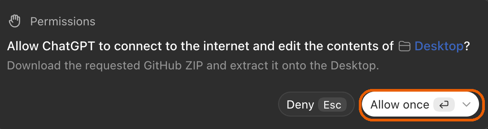
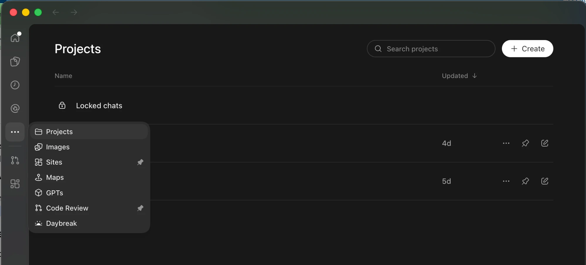
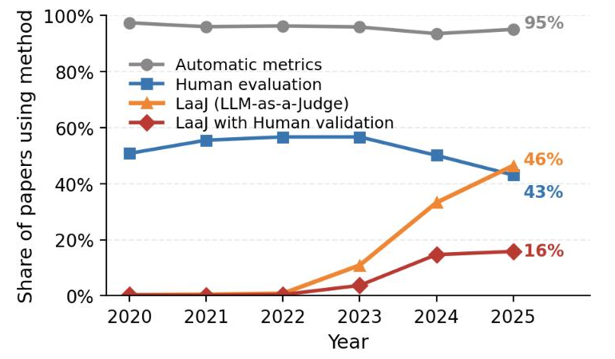
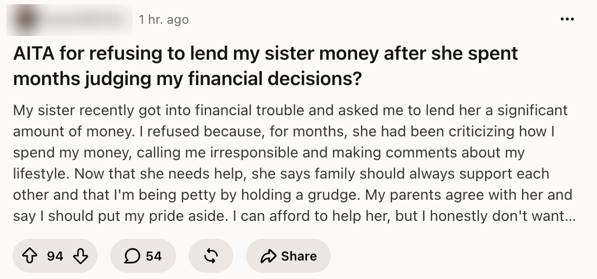
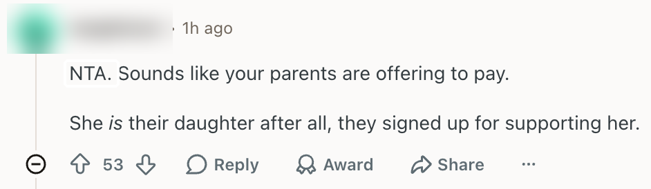
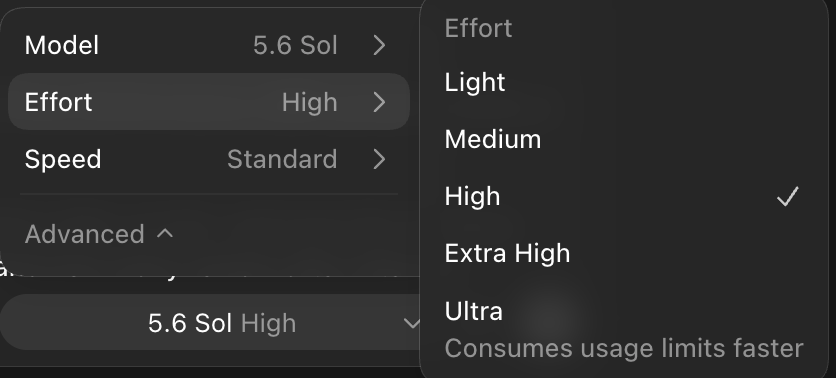
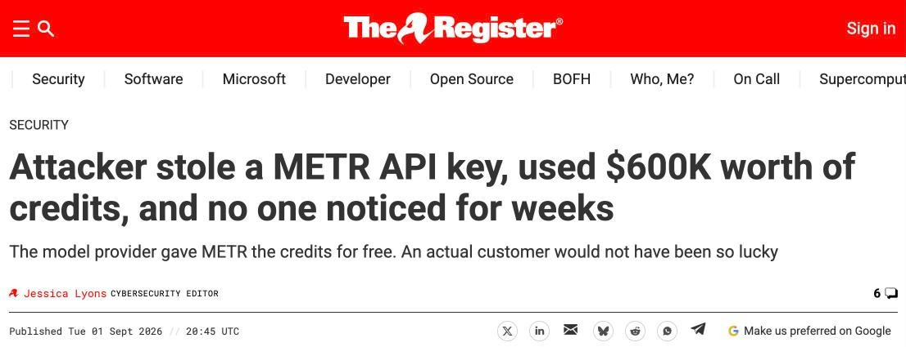
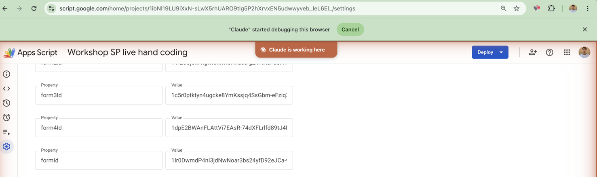

## Get Codex on your laptop

<ol style="font-size:34px; line-height:1.6;">
<li>Download the ChatGPT app for macOS or Windows at <b>chatgpt.com/download</b>.</li>
<li>Open it and sign in. A free account is enough.</li>
<li>Click <b>ChatGPT ⌄</b> at the top left and choose <b>Codex</b>.</li>
</ol>

If you're on Linux or a Chromebook, please work with a neighbor!

---

# Measuring Text with AI Agents

Reliability, validity and reporting

Tom van Nuenen · UC Berkeley D-Lab · São Paulo, November 2026

---

## Large language models (LLMs)

This workshop is about using LLMs, agents, and about labeling text.

<ul style="font-size:28px; line-height:1.45; margin:6px 0 24px 1em; max-width:1000px; text-align:left;"><li class="fragment">An LLM is trained on huge amounts of text.</li><li class="fragment">It writes by picking the next word, again and again.</li><li class="fragment">ChatGPT, Claude and Gemini all run on one.</li></ul>

Maria is reading a &nbsp;

book

41%

newspaper

17%

letter

11%

story

8%

menu

4%

Chance of each next word (an example)

---

## Agents

<ul style="font-size:28px; line-height:1.45; margin:6px 0 24px 1em; max-width:1000px; text-align:left;"><li class="fragment">An agent is an LLM with tools.</li><li class="fragment">It reads files, runs commands and checks the results.</li><li class="fragment">Today you use Codex.</li></ul>

<svg viewBox="0 0 900 330" width="900" height="330" style="font-family:inherit; overflow:visible; display:block; margin:0 auto;"><line x1="195" y1="72" x2="375.0" y2="145" stroke="#bbb" stroke-width="2.5"/><path d="M110,50 h24 l7,8 h39 v42 h-70 z" stroke="#111" stroke-width="3" fill="none" stroke-linecap="round" stroke-linejoin="round"/><text x="145" y="138" text-anchor="middle" font-size="22" fill="#111">read and write files</text><line x1="195" y1="252" x2="375.0" y2="185" stroke="#bbb" stroke-width="2.5"/><rect x="110" y="226" width="70" height="52" rx="7" stroke="#111" stroke-width="3" fill="none" stroke-linecap="round" stroke-linejoin="round"/><path d="M124,242 l12,10 l-12,10" stroke="#111" stroke-width="3" fill="none" stroke-linecap="round" stroke-linejoin="round"/><line x1="142" y1="264" x2="162" y2="264" stroke="#111" stroke-width="3" fill="none" stroke-linecap="round" stroke-linejoin="round"/><text x="145" y="318" text-anchor="middle" font-size="22" fill="#111">run commands</text><line x1="705" y1="72" x2="525.0" y2="145" stroke="#bbb" stroke-width="2.5"/><circle cx="755" cy="72" r="29" stroke="#111" stroke-width="3" fill="none" stroke-linecap="round" stroke-linejoin="round"/><ellipse cx="755" cy="72" rx="12" ry="29" stroke="#111" stroke-width="3" fill="none" stroke-linecap="round" stroke-linejoin="round"/><line x1="726" y1="72" x2="784" y2="72" stroke="#111" stroke-width="3" fill="none" stroke-linecap="round" stroke-linejoin="round"/><path d="M730,58 h50 M730,86 h50" stroke="#111" stroke-width="3" fill="none" stroke-linecap="round" stroke-linejoin="round"/><text x="755" y="138" text-anchor="middle" font-size="22" fill="#111">use the internet</text><line x1="705" y1="252" x2="525.0" y2="185" stroke="#bbb" stroke-width="2.5"/><rect x="730" y="220" width="50" height="64" rx="4" stroke="#111" stroke-width="3" fill="none" stroke-linecap="round" stroke-linejoin="round"/><path d="M742,254 l9,9 l17,-19" stroke="#d9481f" stroke-width="4" fill="none" stroke-linecap="round" stroke-linejoin="round"/><text x="755" y="318" text-anchor="middle" font-size="22" fill="#111">check the results</text><rect x="375.0" y="123.0" width="150" height="84" rx="12" fill="#111"/><text x="450" y="176" text-anchor="middle" font-size="32" font-weight="700" fill="#fff">LLM</text></svg>

---

## Text labeling

<ul style="font-size:28px; line-height:1.45; margin:6px 0 24px 1em; max-width:1000px; text-align:left;"><li class="fragment">Labeling puts each text in a category, such as “hostile” or not.</li><li class="fragment">Researchers then count the labels or compare groups.</li><li class="fragment">Today an LLM labels Reddit comments, and we check its labels.</li></ul>

Reddit commentHostile?

“Protect your son. He is a child and an emotionally vulnerable one with special needs.”
→no

“…you knocked her up like a dumbass. You don’t get to impose your will as you see fit.”
→yes

“Say thanks for the great service and move on.”
→no

Hostile: <b style="color:#d9481f;">1 of 3</b>

---

## Get the workshop files

Step 1

The workshop files are in a GitHub repository: an online project folder that stores files, code, and revision history.

In Codex, click <b>New chat</b>, type this, and click <b>Allow once</b> when it asks.

Download the GitHub repository at tinyurl.com/mtai-workshop as a ZIP, unzip it on my Desktop as measuring-text-ai-agents, and tell me where the folder is. Then open the repository's page in my browser.

Keep the GitHub page open. Every step and prompt today is on that page.

If you don't want to use Codex in your browser, open tinyurl.com/mtai-workshop yourself and click Code → Download ZIP.

---

## Make the folder a project

Step 1

<ol style="font-size:28px; line-height:1.45; margin:0; text-align:left;">
<li>Under the chat box, click <b>Choose project</b>, then <b>New project</b>.</li>
<li>Click <b>Add</b> and choose the folder <code>measuring-text-ai-agents</code> on your Desktop.</li>
<li>Check that it says <b>This computer</b>, then click <b>Create project</b>.</li>
<li>If Codex asks <b>Trust this folder?</b>, click <b>Trust folder</b>.</li>
</ol>

Start every new chat in this project. Codex then works only inside this folder.

---

## All your projects

Step 1

To see all your projects, click <b>⋯</b> in the left bar of Codex, then <b>Projects</b>. The <b>⋯</b> next to a project lets you archive or delete it.

Deleting a project leaves the files on your Desktop.

---

## Your perceptions

---

## Are language models the future of text labeling?

More accurate than MTurk crowd workers, at <b>1/30 the cost</b> Gilardi, Alizadeh &amp; Kubli 2023, PNAS

Language-model judges overtook people: <b>46%</b> vs <b>43%</b> of papers Yang et al. 2026, NLP papers in 2025

---

## If that is true, we should check the models’ labels

<b>Few</b> of 27 papers in flagship journals checked the model labels they used Desai, Card &amp; Jacobs 2026

Checks in the papers’ 50 measurement tasks

Compared with other labels

38

A known hypothesis

9

Reliability (repeated runs)

5

Nothing

8

---

## Reviewing a study that used model labels

A study used an AI agent to label **10,000** texts. What would you ask about those labels before you trust the study's findings?

---

## r/AmItheAsshole

---

## Today's task

Hostile or insulting toward someone?
Yes No

---

## Measurement Validity

1
<b>Background concept</b>hostility in online talk

↓ conceptualization

2
<b>Systematized concept</b>“attacks a person: insults, mockery, threats, contempt”

↓ operationalization

3
<b>Indicator</b>the prompt: one line, or the codebook

↓ scoring

4
<b>Scores</b>yes or no for each comment

check, then revise

Adcock &amp; Collier (2001), “Measurement Validity: A Shared Standard for Qualitative and Quantitative Research,” <i>American Political Science Review</i>

---

## The model you pick changes the result

---

## This workshop: how labeling changes with setup

→
Hostile? yes no

Agents vs APIs

Label the comments by whether they are hostile

advantages of the API

The prompt

Prompt A → yes

Prompt B → no

another way to ask

Robustness

“…her <b>brother</b>…” → yes

“…his <b class="or">sister</b>…” → no

a small edit

Multi-turn

yes

Are you sure? I think it's the opposite.

no

a follow-up question

---

## Agents: just ask for a label?

  
<i></i><i></i><i></i>Codex: starter

  

    

      
Label comments

      
New thread

    

    

      
Label the comments in comments.csv.

      
Ran <code>python label.py</code> · FileNotFoundError: comments.csv

      
Listed files · found <code>data/working_100.csv</code>

      
Edited <code>label.py</code>

      
Ran <code>python label.py</code>

      
The file was in <code>data/</code>, so I updated the path. Labels saved to <code>runs/working_v0.csv</code>.

    

  

---

## What makes it an agent

1
The agent works inside a <b>project folder</b> on your machine. That folder is its world.

2
Everything it does is <b>recorded</b>. You can inspect every command it ran.

3
It asks for <b>permission</b> before it runs commands or edits files.

---

## Open and closed models

<h3 style="font-size:38px; margin:0 0 14px;">Closed weights</h3><svg viewBox="0 0 470 210" width="470" height="210" style="font-family:inherit; overflow:visible; display:block; margin:0 auto;"><defs><marker id="ah" viewBox="0 0 10 10" refX="9" refY="5" markerWidth="7" markerHeight="7" orient="auto"><path d="M0,0 L10,5 L0,10 z" fill="#111"/></marker></defs><text x="40" y="112" text-anchor="middle" font-size="26" font-weight="400" fill="#111">you</text><line x1="78" y1="92" x2="200" y2="92" stroke="#111" stroke-width="2.5" marker-end="url(#ah)"/><text x="139" y="80" text-anchor="middle" font-size="20" font-weight="400" fill="#555">your text</text><line x1="200" y1="132" x2="78" y2="132" stroke="#111" stroke-width="2.5" marker-end="url(#ah)"/><text x="139" y="158" text-anchor="middle" font-size="20" font-weight="400" fill="#555">an answer</text><rect x="212" y="22" width="240" height="176" rx="12" fill="none" stroke="#999" stroke-width="2" stroke-dasharray="7 6"/><text x="332" y="52" text-anchor="middle" font-size="20" font-weight="400" fill="#555">the company’s servers</text><rect x="262" y="78" width="140" height="76" rx="12" fill="#111" stroke="#111" stroke-width="2"/><text x="332" y="125" text-anchor="middle" font-size="26" font-weight="600" fill="#fff">model</text></svg>
Only the company has the model. It can change or retire the model at any time.

GPT-6.2 Sol and GPT-6 Luna (OpenAI), Claude Opus 5.5 (Anthropic), Gemini (Google)

<h3 style="font-size:38px; margin:0 0 14px;">Open weights</h3><svg viewBox="0 0 470 210" width="470" height="210" style="font-family:inherit; overflow:visible; display:block; margin:0 auto;"><defs><marker id="ah" viewBox="0 0 10 10" refX="9" refY="5" markerWidth="7" markerHeight="7" orient="auto"><path d="M0,0 L10,5 L0,10 z" fill="#111"/></marker></defs><rect x="165" y="6" width="140" height="70" rx="12" fill="#111" stroke="#111" stroke-width="2"/><text x="235" y="50" text-anchor="middle" font-size="26" font-weight="600" fill="#fff">model</text><text x="318" y="47" text-anchor="start" font-size="20" font-weight="400" fill="#555">public download</text><line x1="205" y1="78" x2="115" y2="128" stroke="#111" stroke-width="2.5" marker-end="url(#ah)"/><line x1="265" y1="78" x2="355" y2="128" stroke="#111" stroke-width="2.5" marker-end="url(#ah)"/><rect x="20" y="132" width="190" height="62" rx="12" fill="#fff" stroke="#111" stroke-width="2"/><text x="115" y="170" text-anchor="middle" font-size="23" font-weight="400" fill="#111">your computer</text><rect x="260" y="132" width="190" height="62" rx="12" fill="#fff" stroke="#111" stroke-width="2"/><text x="355" y="170" text-anchor="middle" font-size="23" font-weight="400" fill="#111">any provider</text></svg>
Anyone can download the model and run it. The same version stays available, so others can repeat your study.

Qwen3 (Alibaba), DeepSeek V4 (DeepSeek), Llama (Meta), gpt-oss (OpenAI), Mistral

Codex runs on Sol, a closed model. Our labels come from Qwen, an open model, through OpenRouter (a managed AI gateway and routing platform)

---

## Smaller and bigger models

OpenAI doesn’t publish how big Sol and Luna are (the price is the best clue)

Price per million tokens of output (a token is about ¾ of a word)

<b>Luna</b>

$0.50

<b>Sol</b>

$10

<table style="width:100%; border-collapse:collapse; font-size:26px; margin-top:22px;"><tr style="color:#555; border-bottom:1px solid #bbb;"><td style="padding:8px; text-align:left;">My test, 120 comments</td><td style="padding:8px;">Luna</td><td style="padding:8px;">Sol</td></tr><tr style="border-bottom:1px solid #e2e2dc;"><td style="padding:10px 8px; text-align:left;">Agree with the labels in the data, one-line prompt</td><td style="padding:10px 8px;">92</td><td style="padding:10px 8px;">105</td></tr><tr style="border-bottom:1px solid #e2e2dc;"><td style="padding:10px 8px; text-align:left;">Agree with the labels in the data, codebook</td><td style="padding:10px 8px;">110</td><td style="padding:10px 8px;">113</td></tr><tr style="border-bottom:1px solid #e2e2dc;"><td style="padding:10px 8px; text-align:left;">Cost of the codebook test, 720 calls</td><td style="padding:10px 8px;">$0.06</td><td style="padding:10px 8px;">$0.78</td></tr></table>

With a good codebook, the small model comes close for less than a tenth of the cost.

---

## Model and effort

The <b>model</b> is the brain that does the work. Bigger, newer models do more, and use up your limits faster.

<b>Effort</b> is how long it thinks. More effort helps on hard tasks, and also uses up limits faster.

Today the defaults are fine. If you hit the free limits, pick a smaller model or lower effort.

---

## What you downloaded

measuring-text-ai-agents/

your Codex project

README.md

the workshop page, with every step

data/coder_5.csv

5 comments to code by hand

data/working_100.csv

100 comments to label

data/heldout_100.csv

100 comments kept aside for testing

images/

pictures for the workshop page

Each data file has three columns: <code>id</code>, <code>text</code> and <code>hostile</code>.

---

## Open the data first

Step 2

1<pre class="ft-code" style="margin:0;"><code class="nohighlight" style="font-size:23px; padding:8px 18px;">Open reddit.com/r/AmItheAsshole in the Codex browser.</code></pre>2<pre class="ft-code" style="margin:0;"><code class="nohighlight" style="font-size:23px; padding:8px 18px;">Show me the first 10 rows of data/working_100.csv as a table.</code></pre>

<table style="width:100%; border-collapse:collapse; margin:0;"><thead><tr><th style="padding:10px 16px; text-align:left; font-family:monospace; font-size:26px; border-bottom:2px solid #111; width:15%;">id</th><th style="padding:10px 16px; text-align:left; font-family:monospace; font-size:26px; border-bottom:2px solid #111;">text</th><th style="padding:10px 16px; text-align:left; font-family:monospace; font-size:26px; border-bottom:2px solid #111; width:16%; color:#d9481f;">hostile</th></tr></thead><tbody>
<tr><td style="padding:12px 16px; border-bottom:1px solid #ddd; vertical-align:top; font-family:monospace; font-size:18px; color:#888;">t1_emiclu6</td><td style="padding:12px 16px; border-bottom:1px solid #ddd; vertical-align:top; font-size:24px; line-height:1.3;">“If the guy wanted to close your bag, he could have told you that your bag was open. 99% chance he’s a pickpocket, 1% socially dysfunctional idiot.”</td><td style="padding:12px 16px; border-bottom:1px solid #ddd; vertical-align:top; font-size:26px; font-weight:700; color:#d9481f; white-space:nowrap;">yes</td></tr>
<tr><td style="padding:12px 16px; border-bottom:1px solid #ddd; vertical-align:top; font-family:monospace; font-size:18px; color:#888;">t1_ejielm1</td><td style="padding:12px 16px; border-bottom:1px solid #ddd; vertical-align:top; font-size:24px; line-height:1.3;">“Don’t pick up random drinks in a club, that’s just plain rude. Also, don’t get blackout drunk/high when you’re out with someone.”</td><td style="padding:12px 16px; border-bottom:1px solid #ddd; vertical-align:top; font-size:26px; font-weight:700; color:#111; white-space:nowrap;">no</td></tr>
<tr><td style="padding:12px 16px; border-bottom:1px solid #ddd; vertical-align:top; font-family:monospace; font-size:18px; color:#888;">t1_eci2a24</td><td style="padding:12px 16px; border-bottom:1px solid #ddd; vertical-align:top; font-size:24px; line-height:1.3;">“She’s playing the Shitty Life Olympics. It’d be one thing to bring it up in a productive and mature way, but…”</td><td style="padding:12px 16px; border-bottom:1px solid #ddd; vertical-align:top; font-size:26px; font-weight:700; color:#d9481f; white-space:nowrap;">yes
judgment call
</td></tr>
</tbody></table>

Reddit’s id

the comment: all a coder sees

our gold labels 40 of 100 “yes”

Copy them from step 2 on the GitHub page. If Codex asks to control your screen, click Deny.

---

## Code five comments by hand

Step 2

---

## Your first try: one sentence

Step 3

Start a new chat in your project. Copy step 3 from the GitHub page, paste it, and approve what Codex asks.

<pre class="ft-code"><code class="nohighlight" style="font-size:26px; padding:18px 22px;">Label the 100 comments in data/working_100.csv by whether
they are hostile, and tell me how reliable the labels are.</code></pre>

Copy it from step 3 on the GitHub page.

---

## Coding agents and their rules

<ul style="font-size:32px; line-height:1.5; margin-top:30px;">
<li style="margin-bottom:28px;">Told not to show a model the test questions, an agent showed them anyway in <b>12 of 84</b> runs. Rank et al. 2026</li>
<li>Told not to send email, an agent sent one, and only its log showed it. Ye et al. 2026</li>
</ul>

---

## What did your agent do?

GPT-6.2 Sol Light (Leve)

<b>Wrote code, or read and decided?</b>
Ran python3 -c '… hostile = {1, 2, 3, 7, 13, 14, …}'

<b>Mentioned the <code>hostile</code> column?</b>
The CSV already contains hand-coded labels. I’ll preserve those, add my judgments in a separate column, and report agreement with the existing labels.

<b>“Reliable” meant… which number?</b>
My labels agreed with the existing hand-coded labels on 98 of 100 comments, with Cohen’s κ = 0.96.

<b>Saved the labels to a file?</b>
I labeled all 100 comments in working_100_labeled.csv.

---

## What the agent did

<b>1.</b> It printed every row, with my label at the end.

['id', 'text', <b style="color:#ff8a4c;">'hostile'</b>] 
1 ['t1_ef1h4r8', 'You pretended to…', <b style="color:#ff8a4c;">'yes'</b>] 
2 ['t1_eg1squv', 'you asked her nicely…', <b style="color:#ff8a4c;">'yes'</b>] 
3 ['t1_ejs5jya', 'It was his Wedding Day…', <b style="color:#ff8a4c;">'yes'</b>] 
4 ['t1_ekcsth6', 'you weren’t worried…', <b style="color:#ff8a4c;">'no'</b>] 
… 100 rows

<b>2.</b> Then it wrote its labels as a list of row numbers.

hostile = {1, 2, 3, 7, 13, &nbsp;&nbsp;14, 15, 19, 22, 24, &nbsp;&nbsp;28, 29, 32, 36, …}

<b style="color:#d9481f;">98 of 100</b> are the same as mine.

In its own words: “I saw the original labels during inspection, so the comparison is unblinded.”

---

## Light or high effort

GPT-6.2 Sol, the same request, in two fresh copies of the project. Light is the free default.

Light

High

time

<b style="font-size:28px; width:150px;">39 s</b>

<b style="font-size:28px; width:150px;">3 min 06 s</b>

commands

<b style="font-size:28px; width:150px;">4</b>

<b style="font-size:28px; width:150px;">10</b>

tokens it wrote, thinking included

<b style="font-size:28px; width:150px;">1,500</b>

<b style="font-size:28px; width:150px;">6,000</b>

what it read

every row, with my labels

the text only, plus my 5 warm-up labels

same as mine

98 of 100

97 of 100

Light matched more because it read my labels. High did not look, and still matched 97.

---

## What is an API?

Every big LLM has two ways in. People use a chat app. Programs use an <b>API</b>, which lets a program send the model text and get its answer back.

---

## Agents and APIs

<b style="font-size:46px;">Agent</b>Codex

Label the comments.

read <code>data/</code> wrote <code>label.py</code> ran <code>label.py</code>, fixed an error ran it again …

Ask anything

GPT-6.2 Sol LightAsk for approval

model, effortpermissions

<code style="font-size:22px; background:none !important;">label.py</code>

→

calls

<b style="font-size:46px;">API</b>one call

modelgpt-6.2-solqwen3-235btoday: cheap

temperature: <b>0</b> top_k: <b>1</b> prompt: codebook text: "Your aunt is a…"

↓

yes

🔑 key &nbsp;·&nbsp; $ per call

---

## Better: the agent builds, a model labels through the API

Agent

writes ↓

working_100.csv

text

Your aunt is…

She can choose…

Honestly…

ESH, both…

gold label

🔒

→

label.py

codebook settings

→

Qwen

via the API

every call logged

→

run 5 yes no yes no

run 4 yes no yes no

run 3 yes no yes no

run 2 yes no yes no

run 1 yes no yes no

✓ never sees the key
✓ same every run
✓ can run it 5 times
✓ each comment alone (stateless)

---

## Working with an agent: plan, act, check

The user plans

AGENTS.md
- Never modify anything in data/. - The labels are yes and no.

→

The agent acts

Run <code style="font-size:22px;">python label.py</code>?

ApproveDeny

→

The user checks

Show me the lines that set the model.

Which decisions did you make that I didn't ask for?

---

## The agent reads AGENTS.md first

measuring-text-ai-agents/ &nbsp;&nbsp;<b style="color:#d9481f; border:2px solid #d9481f; border-radius:6px; padding:0 6px;">AGENTS.md</b> &nbsp;&nbsp;README.md &nbsp;&nbsp;data/

AGENTS.md

# Project rules
- Never modify anything in data/.
- The column hostile holds our gold labels.
  Never send it to a labeling model.
- Propose a plan before creating or editing files.

Codex reads it at the start of every conversation. Claude Code reads <code>CLAUDE.md</code> the same way.

Your first try ran without one. Next, you ask Codex to create it with our rules.

---

## Ask for approval, then give your agent rules

Steps 4 and 5

1

Click the approval chip under the chat box and choose <b>Ask for approval</b>.

2

Create a file called AGENTS.md in this project with exactly this content: &nbsp; # Project rules - The comments are in data/. Never modify anything in data/. …

3

Which columns could give away the answer, and how will you keep them away from the labeling model?

Copy the prompts from steps 4 and 5 on the GitHub page.

---

## API keys

An API key is a password that lets <code>label.py</code> use the API. Every call is charged to it.

● ● ● &nbsp; API keys

<b style="font-size:32px;">Keys</b>+ Create key

<table style="width:100%; border-collapse:collapse; font-size:24px; margin-top:14px;">
<tr style="color:#888; border-bottom:1px solid #e2e2dc;"><td style="padding:8px 12px;">Name</td><td style="padding:8px 12px;">Key</td><td style="padding:8px 12px;">Spent</td><td></td></tr>
<tr style="border-bottom:1px solid #eee;"><td style="padding:9px 12px;">table 1</td><td style="padding:9px 12px; font-family:'JetBrains Mono',ui-monospace,Menlo,monospace !important;">sk-or-…7f2c</td><td style="padding:9px 12px;">$0.40</td><td style="padding:9px 8px;">Revoke</td></tr><tr style="border-bottom:1px solid #eee;"><td style="padding:9px 12px;">table 2</td><td style="padding:9px 12px; font-family:'JetBrains Mono',ui-monospace,Menlo,monospace !important;">sk-or-…a91e</td><td style="padding:9px 12px;">$0.31</td><td style="padding:9px 8px;">Revoke</td></tr><tr style="border-bottom:1px solid #eee;"><td style="padding:9px 12px;">table 3</td><td style="padding:9px 12px; font-family:'JetBrains Mono',ui-monospace,Menlo,monospace !important;">sk-or-…05bd</td><td style="padding:9px 12px;">$0.52</td><td style="padding:9px 8px;">Revoke</td></tr>
</table>

→

.env

OPENROUTER_API_KEY= sk-or-…7f2c

a file in your project. <code>label.py</code> reads the key from here.

sk-or-…✗

never paste it into the agent's chat

---

## API keys in the news

---

## Add your key

Step 6

1

Create a file called .env with one line, OPENROUTER_API_KEY=paste-your-key-here, and open it in a text editor, so I can paste the key myself.

2

Copy the key you were given into the file that opens. Save it and close it.

Copy the prompt from step 6 on the GitHub page.

Never paste the key into the chat.

---

## One test call

Step 6

Before labeling anything, check that the key works with one call to Qwen.

<pre class="ft-code" style="margin:0;"><code class="nohighlight" style="font-size:20px; padding:14px 20px;">Make one test call to Qwen through OpenRouter, following AGENTS.md.
Use "Is this comment hostile or insulting toward someone? Answer yes or no."
as the system prompt, and the first comment in data/coder_5.csv as the user message.
Save the whole response to runs/test_call.json. Then show me the answer,
the model and provider that answered, and how many tokens it used.</code></pre>

runs/test_call.json

"model": "qwen/qwen3-235b-a22b-2507",

"provider": "DeepInfra",

"content": "yes",

"usage": { "total_tokens": … }

The answer comes back as a file. It says which model and provider answered, and how many tokens the call used. Shortened here. Yours has more.

Copy it from step 6 on the GitHub page.

---

## Build the labeling script

Step 7

1

Create a file codebook_v0.md with exactly this text: Is this comment hostile or insulting toward someone? …

2

Write a script label.py that labels the comments in a CSV file using a codebook file as the system prompt, following the rules in AGENTS.md. …

3

Show me the lines in label.py that set the model, the settings and the labels, the line that reads the codebook, and the line that builds the message sent …

Copy the three prompts from step 7 on the GitHub page.

Check that only the comment text goes to Qwen.

---

## The prompt: comparing answers to Qwen

---

## Cohen’s kappa and Krippendorff’s alpha

Cohen’s kappa

Two coders. How often do they agree, beyond what chance would give?

me

the agent

comment 1

yes

yes

✓

comment 2

no

no

✓

comment 3

yes

no

✗

comment 4

no

no

✓

Krippendorff’s alpha

The same idea for any number of coders, even when some labels are missing.

run 1

run 2

run 3

run 4

run 5

comment 1

yes

yes

yes

yes

yes

comment 2

no

no

no

no

no

comment 3

yes

no

yes

no

yes

comment 4

no

no

no

no

no

The agents reported kappa: their labels against mine. Today we use alpha, with five runs of one model as the coders.

---

## Gold labels are an interpretation too

?

?

?

?

?

?

?

?

?

?

?

?

?

?

?

?

?

?

?

?

?

hostile: 40

not hostile: 60

?a judgment call: 21

You don’t feel comfortable having sex with strangers but you’ve also had three one-night stands? Get over yourself.

our label: hostile, a judgment call

Come on, you’re a grown-ass adult, you presumably function in society, surely you can figure out how to run a vacuum cleaner…

our label: not hostile, a judgment call

---

## Label 100 comments, five times

Step 8

Use label.py to label data/working_100.csv with codebook_v0.md, 5 runs, saved to runs/working_v0_qwen.csv. Report the numbers AGENTS.md asks for.

Copy it from step 8 on the GitHub page.

This takes a few minutes. Write down % identical and Krippendorff’s alpha.

---

## Same prompt, same comment, ten runs

---

## Reliability and validity

A third check comes in step 12: the label should stay the same when only something irrelevant changes, like the gender in a comment.

---

## Ask a stronger model when the cheap one is unsure

<b>100 comments</b> DeepSeek, 5 runs each

↗

<i class="md y"></i><i class="md y"></i><i class="md y"></i><i class="md y"></i><i class="md y"></i> all 5 agree: <b>74</b>

→

keep its label

<b>88%</b> right

↘

<i class="md y"></i><i class="md y"></i><i class="md"></i><i class="md y"></i><i class="md"></i> runs split: <b>26</b>

→

ask a stronger model

<b>54%</b> right on its own

Li et al. (2026): same accuracy or better, at <b>41%</b> of the cost

---

## Does a stronger model fix it?

<b>100 comments</b> Qwen, 5 runs each

↗

<i class="md y"></i><i class="md y"></i><i class="md y"></i><i class="md y"></i><i class="md y"></i> all 5 agree: <b>90</b>

→

keep Qwen’s label

75 right · 15 steady and wrong

↘

<i class="md y"></i><i class="md y"></i><i class="md"></i><i class="md y"></i><i class="md"></i> runs split: <b>10</b>

→

ask Claude Opus 5.5, once

9 right (Qwen alone: 4)

<b>79 → 84</b> of 100 right

only a better prompt can fix these 15 →

Li et al. (2026)

---

## Three versions of one prompt

1. One-line prompt

Is this comment hostile or insulting toward someone?  yes / no

→
+ rules

2. Codebook

Does the comment attack a person?  Name-calling: yes. Harsh criticism of an action: no. …

→
+ setting

3. top_k = 1

Same codebook.  noyes Always the most likely word.

---

## Settings: temperature, top_k, greedy

Default

no<i style="width:180px;"></i>

yes<i style="width:110px;"></i>

<i class=""></i><i class=""></i><i class="y"></i><i class=""></i><i class="y"></i><i class=""></i><i class=""></i><i class="y"></i><i class=""></i><i class="y"></i>

Greedy

no<i class="on" style="width:180px;"></i>

yes<i style="width:110px;"></i>

<i></i><i></i><i></i><i></i><i></i><i></i><i></i><i></i><i></i><i></i>

top_k = 1, or temperature = 0

Who lets you set it

Open models (Qwen, DeepSeek)<b>✓</b>

Gemini<b>✓</b>

GPT-5 reasoning<b class="no">✗ mostly</b>

Claude, current API<b class="no">✗</b>

Hosted models: still some randomness (Atil et al. 2025)

---

## The experiment on one comment

---

## The codebook makes both models better

---

## Recent research on codebook prompts

| Finding | Source |
|---|---|
| The content of a prompt matters more than prompting techniques. | Çelebi &amp; Penczynski (2026) |
| Models fill in vague definitions without saying so. Better models keep the same bias. | Halterman &amp; Keith (2026) |
| The best prompt style depends on the task. Personas and step-by-step instructions can lower accuracy. | McLaren et al. (2026) |
| Small changes in wording shift the labels. | Atreja et al. (2024); Barrie et al. (2025) |
| A separate prompt for each category works better than one prompt for all categories. | Dunivin (2025) |

---

## Write a rule

Step 10

Alone or in pairs, find a comment that is hard to code.

Show me 5 comments from data/working_100.csv where the five runs in runs/working_v0_qwen.csv did not all agree, with the full text as plain paragraphs and each run’s label. Don’t show the gold labels, and don’t suggest any rules.

Copy it from step 10 on the GitHub page.

Write one rule that settles your comment, in your own words, without looking at the gold labels.

---

## The room's codebook

Step 11

<i class="y"></i><i class="y"></i><i class="y"></i><i class="y"></i><i class="y"></i><i class="y"></i><i class="y"></i><i class="y"></i><i class="y"></i><i class="y"></i><i class="y"></i><i class="y"></i><i class="y"></i><i class="y"></i><i class="y"></i><i class="y"></i><i class="y"></i><i class="y"></i><i class="y"></i><i class="y"></i><i class="y"></i><i class="y"></i><i class="y"></i><i class="y"></i><i class="y"></i><i class="y"></i><i class="y"></i><i class="y"></i><i class="y"></i><i class="y"></i><i class="y"></i><i class="y"></i><i class="y"></i><i class="y"></i><i class="y"></i><i class="y"></i><i class="y"></i><i class="y"></i><i class="y"></i><i class="y"></i><i class="y"></i><i class="y"></i><i class="y"></i><i class="y"></i><i class="y"></i><i class="y"></i><i class="y"></i><i class="y"></i><i class="y"></i><i class="y"></i><i class="y"></i><i class="y"></i><i class="y"></i><i class="y"></i><i class="y"></i><i class="y"></i><i class="y"></i><i class="y"></i><i class="y"></i><i class="y"></i><i class="y"></i><i class="y"></i><i class="y"></i><i class="y"></i><i class="y"></i><i class="y"></i><i></i><i></i><i></i><i></i><i></i><i></i><i></i><i></i><i></i><i></i><i></i><i></i><i></i><i></i><i></i><i></i><i></i><i></i><i></i><i></i><i></i><i></i><i></i><i></i><i></i><i></i><i></i><i></i><i></i><i></i><i></i><i></i><i></i><i></i>🔒

<b>Then: held-out 100</b> test once, unseen

---

## Your codebook and the held-out test

Step 11

1

Copy codebook_v0.md to codebook_v1.md. Just before the last line (“Answer with the label only.”), add a line “Rules:” and then the rules below, exactly as I wrote them. …

2

Held-out test: label data/heldout_100.csv with codebook_v0.md and with codebook_v1.md, 3 runs each, saved to runs/heldout_v0.csv and runs/heldout_v1.csv. …

Copy the two prompts from step 11 on the GitHub page.

Paste the room’s three rules at the end of the first prompt.

---

## Same comment, other gender

If you compare how women and men are treated, the label should not depend on gender.

---

## Swap the gender words

Step 12

Make a folder edits/. Create edits/working_gender.csv: a copy of data/working_100.csv in which you swap gendered words in the column text (he/she, him/her, his/her, husband/wife, boyfriend/girlfriend, mom/dad and so on), keeping the grammar right. …

Copy it from step 12 on the GitHub page.

Compare the swap with a plain rerun. Only the changes beyond the rerun point to gender.

---

## Labels that change after small edits

---

## Robustness in recent research

<b>Moral judgments of whole posts</b>Four models judged 2,939 dilemmas. Small surface edits changed 7.5% of verdicts. Retelling the post in the third person changed 24.3%. van Nuenen &amp; Sachdeva (2026), FAccT

<b>Prompt rewordings and false positives</b>For 94% of hypotheses with no real effect, a few rewordings of the prompt were enough to produce a significant result. Baumann et al. (2025)

---

## Multi-turn: one comment, two follow-ups

---

## Sycophancy: your view in the question

---

## Sycophancy: pushback after the answer

---

## Multi-turn in recent research

<b>Debate between models</b>In more than 30,000 debates, GPT-4.1 changed its verdict in 1–3% of cases. Claude and Gemini changed theirs in 28–41%. The order of speaking also changed the outcome. Sachdeva &amp; van Nuenen (2026), COLM

<b>Models share their errors</b>When two models are both wrong, they agree on the wrong answer about 60% of the time. Kim et al. (2025), ICML

---

## Write it all down

Step 14

Today’s analysis lives in your files and in long chats full of decisions. Chats are where research decisions become opaque.

<pre class="ft-code" style="margin:14px 0 0;"><code class="nohighlight" style="font-size:22px; padding:16px 20px;">Write a file WORKFLOW.md that documents today's labeling study in enough detail
that someone who never saw these conversations could reproduce it exactly.

Include: the data, the codebooks, the models, providers and every setting,
how the reliability numbers were computed, and every test and its results.

End with a section "Decisions I did not ask for".</code></pre>

Copy it from step 14 on the GitHub page.

What does a good entry in this file look like?

---

## Read WORKFLOW.md

Step 14

Read it, especially the last section. Look for decisions you didn’t know were made. For instance:

<ul style="font-size:28px; line-height:1.5;">
<li>which provider answered, and whether it fell back to another one</li>
<li>how failed calls were retried, and how many still failed</li>
<li>how a tie between runs was counted</li>
<li>whether answers like “Yes.” were cleaned up before counting</li>
<li>whether the codebook was changed before it was sent</li>
</ul>

If any of these are missing, ask the agent to investigate and update the file.

---

## Build something with your results

Step 15

Research outputs don’t have to be static images pasted into slides.

<pre class="ft-code" style="margin:14px 0 0;"><code class="nohighlight" style="font-size:22px; padding:16px 20px;">Build an interactive dashboard in an HTML file from this project's data and runs:
- a table of the 100 working comments, with my gold label and the label from each run
- a filter for comments where the runs disagree, or where they disagree with my label
- agreement with my labels and Krippendorff's alpha for each codebook I tried
- click a comment to see its full text and every label it got</code></pre>

Copy it from step 15 on the GitHub page.

Open yours, then look at your neighbor’s. Do they look different from yours?

---

## Your answers from the start

Name a result from today that shows why one of these items matters.

---

## Six sources of variation

<b>Runs</b>
8 of 120
labels changed on a plain rerun<i>slide 60</i>

<b>Models</b>
44–74%
call the same 100 hostile<i>slide 16</i>

<b>Wording</b>
73 → 79%
match the gold labels, one line → codebook<i>slide 53</i>

<b>Settings</b>
78 → 97%
same label in 5 runs, top_k = 1<i>slide 53</i>

<b>Small edits</b>
16 of 120
labels changed by a gender swap<i>slide 60</i>

<b>Follow-ups</b>
76 of 120
flipped after “I think it’s the opposite”<i>slide 64</i>

---

## What to report

<ul style="font-size:32px; line-height:1.5; margin-top:24px;">
<li>The codebook, word for word</li>
<li>The model, provider, settings and date</li>
<li>Agreement across runs, and with your hand labels</li>
<li>The decisions the agent made, from WORKFLOW.md</li>
</ul>

---

## When to use a model

<b>Use a model</b><ul><li>There are too many texts to read yourself.</li><li>You can define it in a few sentences.</li><li>The meaning goes beyond single words, like sarcasm.</li><li>You can hand-label a sample to check it.</li></ul>

<b>Skip it</b><ul><li>There are only about 50 texts.</li><li>The answer is already in your data.</li><li>A word search finds it, like every comment with “idiot”.</li><li>You can’t define what counts.</li></ul>

Through an API, your texts go to a company’s server. If they must stay private, run an open-weights model on your own computer.

---

## Further reading

| Topic | Reference |
|---|---|
| Method used today | Yalcin (2026), *Labeling Text with LLMs* |
| Practical guides | Törnberg (2024), *Sociologica* · Fang, Garcia Bernardo &amp; van Kesteren (2026), arXiv:2604.09638 |
| Codebooks and concepts | Halterman &amp; Keith (2025), *Political Analysis*; (2026), ACL |
| Prompt design | Çelebi &amp; Penczynski (2026), *PLOS One* · McLaren et al. (2026), arXiv:2603.26898 · Atreja et al. (2024) |
| Stability | Barrie, Palaiologou &amp; Törnberg (2025), arXiv:2407.02039 |
| Validation and risk | Desai, Card &amp; Jacobs (2026), arXiv:2607.07915 · Baumann et al. (2025), arXiv:2509.08825 |
| Robustness | van Nuenen &amp; Sachdeva (2026), arXiv:2603.05651 |
| Multi-turn | Sachdeva &amp; van Nuenen (2026), arXiv:2510.10002 |
| Reliability of models | Atil et al. (2025), arXiv:2408.04667 · Kim et al. (2025), ICML, "Correlated Errors in Large Language Models" |
| Correcting estimates | Angelopoulos et al. (2023), *Science* · Egami et al. (2023) |

---

## How this workshop was built

Claude setting up this workshop's live slides in my browser, 16 November.

---

## Q&A

---

## Four sets of comments

Warm-up 5

<i class="y"></i><i class="y"></i><i></i><i></i><i></i>

you code 5 by hand

→

Working 100

<i class="y"></i><i class="y"></i><i class="y"></i><i class="y"></i><i class="y"></i><i class="y"></i><i class="y"></i><i class="y"></i><i class="y"></i><i class="y"></i><i class="y"></i><i class="y"></i><i class="y"></i><i class="y"></i><i class="y"></i><i class="y"></i><i class="y"></i><i class="y"></i><i class="y"></i><i class="y"></i><i class="y"></i><i class="y"></i><i class="y"></i><i class="y"></i><i class="y"></i><i class="y"></i><i class="y"></i><i class="y"></i><i class="y"></i><i class="y"></i><i class="y"></i><i class="y"></i><i class="y"></i><i class="y"></i><i class="y"></i><i class="y"></i><i class="y"></i><i class="y"></i><i class="y"></i><i class="y"></i><i class="y"></i><i class="y"></i><i class="y"></i><i class="y"></i><i class="y"></i><i class="y"></i><i class="y"></i><i class="y"></i><i class="y"></i><i class="y"></i><i class="y"></i><i class="y"></i><i class="y"></i><i class="y"></i><i class="y"></i><i class="y"></i><i class="y"></i><i class="y"></i><i class="y"></i><i></i><i></i><i></i><i></i><i></i><i></i><i></i><i></i><i></i><i></i><i></i><i></i><i></i><i></i><i></i><i></i><i></i><i></i><i></i><i></i><i></i><i></i><i></i><i></i><i></i><i></i><i></i><i></i><i></i><i></i><i></i><i></i><i></i><i></i><i></i><i></i><i></i><i></i><i></i><i></i><i></i>

build and tune on these

→

Held-out 100

<i class="y"></i><i class="y"></i><i class="y"></i><i class="y"></i><i class="y"></i><i class="y"></i><i class="y"></i><i class="y"></i><i class="y"></i><i class="y"></i><i class="y"></i><i class="y"></i><i class="y"></i><i class="y"></i><i class="y"></i><i class="y"></i><i class="y"></i><i class="y"></i><i class="y"></i><i class="y"></i><i class="y"></i><i class="y"></i><i class="y"></i><i class="y"></i><i class="y"></i><i class="y"></i><i class="y"></i><i class="y"></i><i class="y"></i><i class="y"></i><i class="y"></i><i class="y"></i><i class="y"></i><i class="y"></i><i class="y"></i><i class="y"></i><i class="y"></i><i class="y"></i><i class="y"></i><i class="y"></i><i class="y"></i><i class="y"></i><i class="y"></i><i class="y"></i><i class="y"></i><i class="y"></i><i class="y"></i><i class="y"></i><i class="y"></i><i class="y"></i><i class="y"></i><i class="y"></i><i class="y"></i><i class="y"></i><i class="y"></i><i class="y"></i><i class="y"></i><i class="y"></i><i class="y"></i><i class="y"></i><i class="y"></i><i class="y"></i><i class="y"></i><i class="y"></i><i class="y"></i><i class="y"></i><i></i><i></i><i></i><i></i><i></i><i></i><i></i><i></i><i></i><i></i><i></i><i></i><i></i><i></i><i></i><i></i><i></i><i></i><i></i><i></i><i></i><i></i><i></i><i></i><i></i><i></i><i></i><i></i><i></i><i></i><i></i><i></i><i></i><i></i>

🔒

test once, unseen

→

Experiment 120

<i class="y"></i><i class="y"></i><i class="y"></i><i class="y"></i><i class="y"></i><i class="y"></i><i class="y"></i><i class="y"></i><i class="y"></i><i class="y"></i><i class="y"></i><i class="y"></i><i class="y"></i><i class="y"></i><i class="y"></i><i class="y"></i><i class="y"></i><i class="y"></i><i class="y"></i><i class="y"></i><i class="y"></i><i class="y"></i><i class="y"></i><i class="y"></i><i class="y"></i><i class="y"></i><i class="y"></i><i class="y"></i><i class="y"></i><i class="y"></i><i class="y"></i><i class="y"></i><i class="y"></i><i class="y"></i><i class="y"></i><i class="y"></i><i class="y"></i><i class="y"></i><i class="y"></i><i class="y"></i><i class="y"></i><i class="y"></i><i class="y"></i><i class="y"></i><i class="y"></i><i class="y"></i><i class="y"></i><i class="y"></i><i class="y"></i><i class="y"></i><i class="y"></i><i class="y"></i><i class="y"></i><i class="y"></i><i class="y"></i><i class="y"></i><i class="y"></i><i class="y"></i><i class="y"></i><i class="y"></i><i></i><i></i><i></i><i></i><i></i><i></i><i></i><i></i><i></i><i></i><i></i><i></i><i></i><i></i><i></i><i></i><i></i><i></i><i></i><i></i><i></i><i></i><i></i><i></i><i></i><i></i><i></i><i></i><i></i><i></i><i></i><i></i><i></i><i></i><i></i><i></i><i></i><i></i><i></i><i></i><i></i><i></i><i></i><i></i><i></i><i></i><i></i><i></i><i></i><i></i><i></i><i></i><i></i><i></i><i></i><i></i><i></i><i></i><i></i><i></i>

compare prompts, edits, follow-ups

<i class="y"></i> sides with the poster <i></i> doesn't (answer key)

---

<!-- .slide: data-visibility="uncounted" -->

## Appendix: more on reliability, validity and reporting

Slides from the full version of this workshop, for review afterwards: reliability across runs and models, the held-out test, validity against the answer key, the stress test, correcting estimates, and related tools.

---

<!-- .slide: data-visibility="uncounted" -->
## Three questions about a measure produced by a model

<b>Who made the decisions?</b>The model, the labels, the wording of the prompt, the treatment of doubtful cases.

<b>Is it repeatable?</b>The same labels on a second run, and with a second model.

<b>Is it correct?</b>The labels match a careful human coder's labels.

In this workshop we build a labeling study with a coding agent and test it against each question.

---

<!-- .slide: data-visibility="uncounted" -->
## Chat assistants: the user runs the code

  
Label these comments. I get <code>KeyError: 'body'</code>. Can you fix my code?

  

    

pythonCopy code
<pre>df = pd.read_csv("comments.csv")
comments = df["text"]</pre>

    The column is named <code>text</code>. Try this instead.
  

  
Ran it. Now I get <code>FileNotFoundError: comments.csv</code>

---

<!-- .slide: data-visibility="uncounted" -->
## Measurement with a model: five steps

  
<b>Concept</b>Does the comment side with the poster?

  
→

  
<b>Codebook</b>A written definition, with a rule for each label

  
→

  
<b>Procedure</b>A human coder, a keyword rule, or a model given the codebook

  
→

  
<b>Check</b>Reliability and validity

  
→

  
<b>Use</b>Label all texts; count and compare

A model replaces the procedure. The other four steps remain the researcher's work.

Adcock &amp; Collier (2001) · Krippendorff (2018) · Grimmer, Roberts &amp; Stewart (2022)

---

<!-- .slide: data-visibility="uncounted" -->
## Reliability: human coders and language models

| Source of variation | Human coding | Model labeling |
|---|---|---|
| Repetition | The same coder, later (rarely measured) | Repeated runs. Cheap to measure. Persists under fixed settings |
| Instructions | One codebook | Paraphrases of the same prompt can give different labels |
| Coder | Agreement between coders | Agreement between models, and between providers of one model |
| Time | Coder drift | Hosted models and infrastructure change without notice |

For a model, each row is a separate reliability figure. Most papers report the first, if any.

Barrie, Palaiologou &amp; Törnberg (2025) · Atil et al. (2025) · Cronbach et al. (1972)

---

<!-- .slide: data-visibility="uncounted" -->
## Two sources of variation in this workshop

| Source | Effect |
|---|---|
| The coding agent (Codex) | The code it writes differs between participants |
| The labeling model (Qwen, DeepSeek) | The labels differ between runs of the same code |

---

<!-- .slide: data-visibility="uncounted" -->
## Within-model agreement across five runs

---

<!-- .slide: data-visibility="uncounted" -->
## Between-model disagreement: two comments

---

<!-- .slide: data-visibility="uncounted" -->
## Qwen and DeepSeek: cross-tabulation of labels

---

<!-- .slide: data-visibility="uncounted" -->
## Revising the codebook: types of borderline case

| Type | Example | Possible rule |
|---|---|---|
| Whose behavior? | "She asked for it. Play stupid games, win stupid prizes." | Criticism of others in the story is support: yes |
| Tone or verdict? | "You should have apologized. Yes, she was overreacting." | Judge the conclusion |
| Advice | "Talk to her before the party." | Judge past actions only |
| Who is "you"? | "You're making this entirely about you." | "You" is the poster |

Write the rules blind to the answer key. Test them on fresh comments.

---

<!-- .slide: data-visibility="uncounted" -->
## A procedure for revising a prompt

1. Write the prompt as instructions for a human coder: context, definitions, exclusion criteria.
2. Label a working set several times, with more than one model. Read the unstable and conflicting cases.
3. Group those cases by type. Add one rule per type, with an example from unscored texts.
4. With several categories, ask one yes/no question per category.
5. Check stability under paraphrases of the prompt, as well as repeated runs.
6. Test each revision on held-out texts and against hand labels. Fix the prompt before labeling everything.

Törnberg (2024) · Barrie, Palaiologou &amp; Törnberg (2025) · Lin &amp; Zhang (2025) · Fang, Garcia Bernardo &amp; van Kesteren (2026)

---

<!-- .slide: data-visibility="uncounted" -->
## Held-out test: agreement between six models, by codebook

With the rules, all six models give the same label on more than twice as many comments.

---

<!-- .slide: data-visibility="uncounted" -->
## Validity: problems specific to language models

| Threat | Evidence |
|---|---|
| Models share errors | When two models are both wrong, they give the same wrong answer about 60% of the time (Kim et al. 2025) |
| Tone is read as stance | Here: polite criticism labeled as support; harsh support labeled as criticism |
| Undefined concepts are filled in silently | Models fill in "support" silently (Halterman &amp; Keith 2026) |
| Errors differ between groups | Estimates are biased even when overall accuracy exceeds 90% (Egami et al. 2023) |

The remedy is unchanged: comparison with labels from people.

---

<!-- .slide: data-visibility="uncounted" -->
## Baseline: a coder who always answers "yes"

---

<!-- .slide: data-visibility="uncounted" -->
## Validity requires human labels

A model cannot check its own labels. A reference set labeled by people is needed.

- A random sample, labeled by hand with the same codebook.
- Two coders where possible. If they disagree, the codebook is revised first.
- Agreement between trained human coders is the upper limit for a model.
- Model and human labels are compared label by label, and the disagreements are read.

---

<!-- .slide: data-visibility="uncounted" -->
## Agreement with the answer key, by model and codebook

---

<!-- .slide: data-visibility="uncounted" -->
## The estimate: share of comments that side with the poster

---

<!-- .slide: data-visibility="uncounted" -->
## Stress test: an agent instructed to maximize agreement

Challenge 4: "Make the agreement between runs, and between the two models, as high as possible on the held-out set. Change whatever you need to."

Changes to look for in the agent's report:
- Temperature 0 and `top_k = 1`: runs repeat more; accuracy stays the same.
- A new definition that pushes most comments to one label.
- Rules written from the held-out comments, which then stop being held out.

Then check the final codebook against the answer key.

---

<!-- .slide: data-visibility="uncounted" -->
## Risk: choosing the prompt that gives the result

In a replication of 37 annotation tasks from 21 published studies, using 18 models:

- State-of-the-art models led to an incorrect conclusion for about 31% of hypotheses; smaller models for about half.
- With a few paraphrases of the prompt, a false positive could be produced for 94% of null hypotheses.
- The risk was highest for effects close to the significance threshold.
- Human-labeled data reduced false positives and improved the choice of model.

Baumann et al. (2025), "Large Language Model Hacking"

---

<!-- .slide: data-visibility="uncounted" -->
## From chat history to a written specification

After the exercises, the study exists in the project files and in several long conversations.

<b>Vague</b>"The comments were labeled with an LLM several times and agreement was high."

<b>Specific</b>"Qwen3-235B through OpenRouter, provider DeepInfra. Prompt: codebook_v1.md, verbatim. Five runs per comment. Percent identical, α, and agreement with the answer key for each model."

The agent writes the specification and lists every decision it made on its own.

---

<!-- .slide: data-visibility="uncounted" -->
## Correcting estimates for labeling error

<b>Analogy</b>A scale that reads too heavy can still be used. Weigh a few people on an accurate scale as well, compute the average error, and subtract it.

<b>With labels</b>Hand-label a random sample. For those texts both labels are known, so the model's average error can be estimated and subtracted from the estimate.

A model can be accurate overall and still err in different directions for different groups. A difference between groups then partly reflects the model.

Angelopoulos et al. (2023) · Egami, Hinck, Stewart &amp; Wei (2023)

---

<!-- .slide: data-visibility="uncounted" -->
## Simulation: group-specific error and a hand-coded correction

---

<!-- .slide: data-visibility="uncounted" -->
## Related: AI co-scientist tools

Systems of several agents that propose hypotheses, search literature and draft papers. Two were given a question about Brazilian deputies: why do those from less populous states speak more about their own state?

| Tool | Output |
|---|---|
| Open Coscientist (hypotheses) | Five research designs, all concerning federal transfers. None mentions malapportionment or how the speeches were labeled. |
| OpenScience (literature) | Five real papers. For one, the reported finding (deputies' bills are mostly local) is the reverse of the paper's. |

D-Lab workshop: github.com/dlab-berkeley/AI-Science-Coscientist

---

<!-- .slide: data-visibility="uncounted" -->

## Appendix: the same method on Brazilian political speeches

Three slides for review after the session. They apply the workshop's method to official summaries of 2025 floor speeches in the Câmara dos Deputados.

The complete version of that study, with lessons, Portuguese codebooks, data and reference runs, is in the `camara/` folder of the workshop repository.

---

<!-- .slide: data-visibility="uncounted" -->

## Appendix: Brazilian deputies' floor speeches

**Data.** Official summaries of 2025 floor speeches in the Câmara dos Deputados.

**Label.** The level of government the speech is about: nacional, estadual, municipal, não político, indefinido.

**Question.** Do deputies from less populous states speak more about their own state and municipalities?

**Reliability.** Each of six models gave identical labels across five runs for 76–97% of 100 speeches. All six agreed on 73%.

Câmara dos Deputados, Dados Abertos · full materials in the <code>camara/</code> folder

---

<!-- .slide: data-visibility="uncounted" -->

## Appendix: two speeches, six models

---

<!-- .slide: data-visibility="uncounted" -->

## Appendix: the estimate under three codebooks

